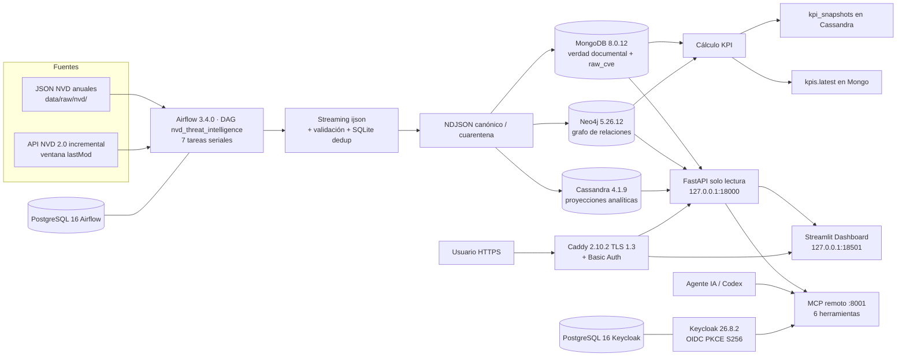

# 02 — Arquitectura, infraestructura y despliegue

> **Referencia histórica anterior a la expansión de Cassandra.** Las cifras, pruebas y comandos son de su corte original, no instrucciones vigentes para GCP. Para la arquitectura y operación actuales, consultar [el cierre distribuido](09_distributed_update.md).

## 2.1 Diagrama lógico de extremo a extremo

Basado en `docs/architecture/system.md:8-32` y código verificado:



## 2.2 Flujo de datos NVD → tres bases (detallado)

```mermaid
sequenceDiagram
  participant NVD as NVD API/Feeds
  participant EX as extract
  participant VA as validate
  participant MG as load_mongodb
  participant CA as load_cassandra
  participant NE as load_neo4j
  participant KP as calculate_kpis
  participant VF as verify
  NVD->>EX: descarga paginada (sync) o lectura streaming (feeds)
  EX->>VA: run_dir con páginas/feeds durables
  VA->>VA: normalize() por registro → SQLite dedup por cve_id<br/>(gana lastModified/hash mayor) → canonical.ndjson
  VA->>MG: lotes de 200
  MG->>MG: ReplaceOne upsert por cve_id (checkpoint dirty-check)
  MG->>CA: documento JSON sin raw + proyecciones por severidad/producto/CWE
  CA->>CA: INSERT/DELETE idempotentes; borra claves viejas del checkpoint
  MG->>NE: MERGE identidades + DELETE/CREATE relaciones salientes del lote
  NE->>KP: consulta Mongo completa + conteos grafo
  KP->>VF: escribe kpis.latest (Mongo) y kpi_snapshots (Cassandra)
  VF->>VF: escanea ID+hash de los TRES motores
  VF-->>NVD: commit_sync: avanza watermark SOLO si paridad exacta
```

## 2.3 Componente por componente

### Airflow 3.4.0
- **Versión verificada**: metadata consultada 16/11 (`docs/evidence/technical_closure/runtime.json`).
- **Responsabilidad**: orquestar el ETL diario; una ejecución activa (`max_active_runs=1`, `max_active_tasks=1`).
- **Ruta**: `airflow/dags/nvd_pipeline.py` (DAG delgado; lógica en `src/threat_intelligence/`).
- **Comunicación**: PostgreSQL 16 propio (`airflow3-postgres`); motores por red Docker `data`.
- **Justificación**: separación metadata/ETL, reintentos nativos con backoff, XCom solo rutas (nunca el dataset).
- **Ejecutores**: LocalExecutor; servicios api-server/scheduler/dag-processor separados.

### FastAPI (API)
- **Versión**: fastapi>=0.115 (lock con hashes en `requirements.lock`).
- **Ruta**: `services/api/app.py` (352 líneas) + `services/api/views.py`.
- **Responsabilidad**: lectura paginada, detalle CVE, rankings, subgrafo, snapshot Cassandra, estado pipeline. Solo lectura: Mongo con usuario `ti_reader`.
- **Endpoints principales**: `/ready` (ping 3 motores), `/api/v1/kpis`, `/api/v1/vulnerabilities`, `/api/v1/vulnerabilities/{id}` (con `view=summary`, `include_applicability`), `/api/v1/graph/cve/{id}` (paginado), `/api/v1/products/top?mode=catalog`, `/api/v1/analytics/cassandra/snapshot`.
- **Seguridad**: middleware rechaza query params desconocidos/duplicados (422); errores 503 sin detalles internos.

### MCP (Model Context Protocol)
- **Ruta**: `services/mcp_server/server.py` (6 herramientas stdio), `remote.py` (Streamable HTTP + OAuth), `contracts.py` (contratos estrictos).
- **Herramientas**: `search_vulnerabilities`, `get_cve_details`, `get_affected_products`, `explore_cve_relationships`, `get_top_cwes`, `get_vulnerability_statistics`.
- **Auth**: Keycloak OIDC, JWT RS256, audience/issuer/scope `ti:read` obligatorios (`remote.py:18-37`).
- **Validación**: confirmación manual del dueño desde Codex App (16/11); 63 checks automatizados SDK→HTTP históricos (11/11).

### Streamlit Dashboard
- **Ruta**: `services/dashboard/app.py` (5 vistas); imagen propia `ti-dashboard:local` (`infrastructure/docker/dashboard.Dockerfile`).
- **Datos**: siempre vía API HTTP (nunca directo a bases); Threat Analytics consulta snapshot Cassandra real vía endpoint dedicado.

### Caddy 2.10.2
- **Ruta**: `infrastructure/docker/Caddyfile` + `scripts/caddy-entrypoint.sh`.
- **Rol**: único punto HTTPS público (80/443), TLS 1.3, Basic Auth para dashboard/API, route bloquea admin Keycloak (404).

### Keycloak 26.8.2
- **Realm** `ti`, cliente confidencial PKCE S256; PostgreSQL propio; import del realm en `secrets/keycloak-realm.json`.

## 2.4 Infraestructura GCP

| Recurso | Detalle verificado | Módulo Terraform |
|---|---|---|
| Proyecto | `proyectobigdata2-514216` | — |
| VM | `ti-dev-data`, e2-standard-4 (4 vCPU/16GB), us-central1-a, RUNNING | `modules/compute` |
| Disco boot | 30 GB pd-balanced, Debian 12, UEFI, deletion_protection | `modules/compute` |
| Disco datos | 100 GB `/srv/ti-data` (Docker volumes + backups + feeds) | `modules/compute` |
| IP | Reservada 136.114.21.18 + hostname sslip.io | `modules/networking` |
| VPC/Subnet | `ti-dev-vpc` 10.42.0.0/24, private Google access | `modules/networking` |
| Firewall | 80/443 público (tag data); 22 solo IAP 35.235.240.0/20; 27017/9042/7687 solo tag `ti-dev-web`→`ti-dev-data` | `modules/networking/main.tf:19-52` |
| Buckets GCS | `...-ti-dev-raw` (feeds) y `...-ti-dev-processed` (backups), US, privados, PAP enforced | `modules/storage` |
| Secret Manager | 10 contenedores de secretos (solo recursos, jamás valores en TF) | `modules/secrets` |
| Artifact Registry | Imágenes de aplicación | `modules/registry` |
| Monitoring | 5 políticas de alerta | `modules/observability` |
| IAM | SA de VM con accessor de secretos, IAP tunnel + osAdminLogin del operador | `modules/iam`, `operator.tf` |
| Cloud Run | Deshabilitado (`web_services={}`) — costo/complejidad | `modules/cloud_run` |

**Red Docker**: `data` (internal, motores sin puertos publicados) y `edge`
(presentación). Solo Caddy publica 80/443; API/dashboard/Airflow escuchan en
loopback de la VM (18000/18501/18081).

## 2.5 Contenedores (13, todos healthy al 16/11)

mongodb:8.0.12 · cassandra:4.1.9 · neo4j:5.26.12-community · api (ti-app) ·
dashboard (ti-dashboard) · mcp-remote (ti-mcp) · caddy:2.10.2-alpine ·
keycloak:26.8.2 · keycloak-db (postgres:16.10) · airflow3-{api,scheduler,dag-processor}
(ti-airflow:3.4-local) · airflow3-postgres (postgres:16.10).

Definición: `docker-compose.yml` + overlays `airflow3`, `secure`, `public`
(con `secrets/public.env` privado). Healthchecks declarados para los 13.

## 2.6 Persistencia, automatización y recuperación

**Volúmenes Docker** en disco de datos `/srv/ti-data/docker/volumes/`:
mongodb_data, cassandra_data, neo4j_data, airflow3_postgres, airflow3_logs,
checkpoint_data, keycloak_postgres, caddy_data/config.

**systemd** (definiciones en `infrastructure/scripts/`):
- `ti-stack.service` (enabled, oneshot+RemainAfterExit): `docker compose up` de los 13 servicios al arranque.
- `ti-backup.timer` diario 02:00 UTC → `ti-backup.service` → `scripts/cloud_backup.py`: pausa DAG, backup frío coordinado (stop writers→dbs, tar.gz volúmenes con SHA-256, subida privada a GCS con identidad de VM, reanuda DAG si estaba activo).
- `ti-health.timer`, `ti-component-health.timer`: sondas externas.

**Recuperación**: `scripts/cloud_restore_three.py` restaura los tres motores
en contenedores scratch (red `none`, sin volúmenes productivos) contra la
huella del último verify anterior al backup. Evidencia 11/11: 3 PASS, 174607
CVE/huella exacta (`docs/evidence/acceptance_v2/restore_three.json`).
Retención: GCS lifecycle 7d + soft-delete 7d.

## 2.7 Ciclos de vida (distinguir para la exposición)

| Fase | Qué pasó | Herramienta | Repetir en vivo |
|---|---|---|---|
| 1. Aprovisionamiento | Terraform aplicado 10-11/11 tras gate de costo (VM, red, discos, buckets, IAM) | `infrastructure/terraform/` | **NO** — no exigido |
| 2. Despliegue apps | Bootstrap VM + Compose up 13 servicios + init usuarios/secretos | `scripts/cloud_install.py`, prepare_*.py | **NO** |
| 3. Operación diaria | Automática: backup 02:00, sync NVD 03:00, Monitoring | timers + DAG | ya corre solo |
| 4. Actualización | Ejemplo real: dashboard 16/11 (build imagen separada, up -d --no-deps dashboard, 12 IDs intactos) | `dashboard.Dockerfile`, rollback tag | demostrable |
| 5. Recuperación | Restore aislado verificado 11/11 en scratch | `cloud_restore_three.py` | solo con autorización |

## 2.8 Seguridad (resumen defendible)

- Motores sin puertos públicos; SSH solo IAP; API Mongo read-only.
- Usuarios Mongo/Cassandra por rol (writer ETL / reader API); nunca admin en runtime.
- Secretos: archivos Docker read-only montados; Terraform solo crea contenedores.
- MCP: OAuth OIDC real (RS256, exp/iat/aud/iss obligatorios, scope ti:read).
- Auditoría: sin credenciales en logs/evidencias (escaneo JWT/PEM 0 hits).
