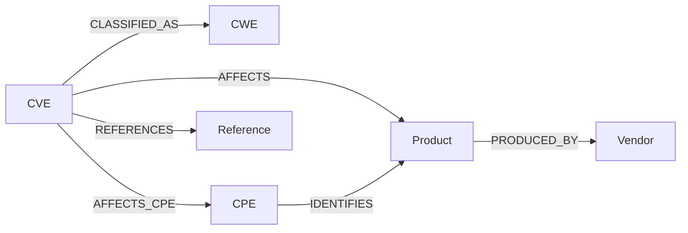

# 03 — Los tres motores: modelos, consultas y CRUD

## 3.0 ¿Por qué TRES motores? (argumento central para el profesor)

Cada motor resuelve un problema que los otros dos resuelven mal:

| Necesidad | MongoDB | Cassandra | Neo4j |
|---|---|---|---|
| Guardar el CVE original completo (raw_cve, ~4.6KB promedio) con esquema flexible | ✅ nativo documental | ❌ no tiene joins ni documentos anidados cómodos | ❌ propiedades planas, duplicaría |
| Consulta analítica por clave compuesta (severidad+mes) con partición precalculada | ⚠️ posible con índices pero escanea más | ✅ **partition key exactamente diseñada por consulta** | ❌ recorrería el grafo |
| Preguntas relacionales: grado de producto, vecinos de CVE, camino CPE→Product | ❌ unwind costoso de arrays | ❌ modelado anti-patrón | ✅ **traversal nativo O(grado)** |
| Escritura idempotente masiva de lotes | ✅ ReplaceOne | ✅ INSERT idempotente | ✅ MERGE |

Decisión documentada en `docs/implementation/decisions.md:6`: *"MongoDB guarda
el documento canónico y el original; Cassandra modela consultas con
particiones mensuales; Neo4j usa identidades CPE y relaciones extraídas, no
inferidas"*. SQLite solo es artefacto local de dedup/checkpoint — **no
sustituye a ninguno de los tres obligatorios** (`system.md:39`).

---

## 3.1 MongoDB 8.0.12

**Elección**: verdad documental canónica; JSON semiestructurado encaja sin
pérdida; raw_cve conservado íntegro para reprocesamiento.

### Esquema real
Base `threat_intelligence`; colecciones `cves`, `kpis`, `pipeline_runs`.

Documento canónico (`src/threat_intelligence/transformations/normalize.py:131-157`):

```json
{
  "cve_id": "CVE-YYYY-NNNN",        // patrón ^CVE-\d{4}-\d{4,19}$
  "content_hash": "<sha256 del doc canónico>",
  "published": "2024-01-02T10:00:00.000000+00:00",  // UTC microsegundos
  "last_modified": "...",
  "month": "2024-01", "year": 2024,   // de PUBLICACIÓN, no del ID
  "status": "Analyzed",               // vulnStatus NVD
  "description": "texto EN preferido",
  "cvss": {"version":"3.1","score":9.8,"severity":"CRITICAL","vector":"CVSS:3.1/...","source":"nvd@nist.gov"},
  "severity": "CRITICAL",             // derivado; UNKNOWN si sin métricas
  "cwes": ["CWE-79"],                 // solo CWE-\d+ válidos, dedup
  "products": [{"id":"[\"a\",\"vendor\",\"product\"]","part":"a","vendor":"...","product":"..."}],
  "cpes": [{"criteria":"cpe:2.3:a:...","product_id":"[...]"}],
  "references": ["https://..."],
  "raw_cve": { ...objeto NVD original completo... }
}
```

Reglas de normalización clave (defendibles):
- CVSS preferido **4.0 > 3.1 > 3.0 > 2.0**, Primary primero (`normalize.py:54-58`); severidad derivada si falta con umbrales por versión.
- Solo `cpeMatch.vulnerable == true` con CPE 2.3 de 13 componentes y vendor/product no comodín (`normalize.py:116-130`).
- Colons escapados de CPE respetados (`cpe_parts`, `normalize.py:17-32`).

### Índices reales (verificados 16/11)
```python
# src/threat_intelligence/databases/mongodb/__init__.py:15-43
cves: validator $jsonSchema (required cve_id, content_hash, published, last_modified;
       pattern CVE) + índices:
  cve_id UNIQUE | last_modified | month | severity | cwes | products.id
  (year,cve_id) | (published,cve_id)   # añadidos tras medir ~5.5s → ~0.1s (decisions.md:28-31)
  description TEXT (inglés)
```

### Consultas principales (API, `services/api/app.py`)
- Búsqueda: find(query, projection).sort(cve_id).skip/limit; `$text` para q.
- Conteo sin filtro con `hint: cve_id_1` (evita escanear GB).
- Detalle por cve_id con proyecciones summary/legacy y `applicability` derivada de raw_cve (`views.py:applicability` — árbol booleano completo con source_path y logical_context por ocurrencia; 396 ocurrencias en Log4Shell vs 358 identidades CPE).

### Ventajas / limitaciones
✅ raw íntegro, upsert idempotente, índices text. ⚠️ skip degrada en páginas profundas; sin transacciones multi-documento usadas.

---

## 3.2 Cassandra 4.1.9

**Elección**: proyecciones analíticas por consulta exacta; partition key
diseñada con query-first; escrituras idempotentes masivas.

### Esquema real (verificado con metadata del cluster, 16/11)
Keyspace `threat_intelligence`, NetworkTopologyStrategy `{'dc1': 1}`, durable_writes.

```sql
-- src/threat_intelligence/databases/cassandra/__init__.py:43-53
CREATE TABLE cves_by_id (cve_id text PRIMARY KEY, content_hash text, document text);
CREATE TABLE cves_by_severity (bucket text, month text, published text, cve_id text,
  severity text, score double, description text,
  PRIMARY KEY ((bucket,month), published, cve_id))
  WITH CLUSTERING ORDER BY (published DESC, cve_id ASC);
CREATE TABLE cves_by_product ( ... misma estructura, bucket=product_id ... );
CREATE TABLE cves_by_cwe    ( ... misma estructura, bucket=CWE ... );
CREATE TABLE kpi_snapshots (snapshot_id text PRIMARY KEY, payload text);
```

**Clave**: `document` = JSON del canónico SIN raw_cve (proyección); en las
tres tablas analíticas la descripción se trunca a 500 caracteres.

### Filosofía de partición
Partition key compuesta `(bucket, month)` — cada consulta analítica conoce
SIEMPRE severidad/producto/CWE y mes → una partición por (clave, mes);
el mes limita el tamaño frente a un año completo. Clustering `published DESC`
da los más recientes primero sin ORDER BY en runtime.

### Consultas reales (sin ALLOW FILTERING)
```sql
SELECT * FROM cves_by_severity WHERE bucket='CRITICAL' AND month='2024-01' LIMIT 25;
SELECT * FROM cves_by_cwes     WHERE bucket='CWE-79'   AND month='2024-01' LIMIT 25;
SELECT document FROM cves_by_id WHERE cve_id='CVE-2021-44228';
```

### Escritura idempotente con limpieza de claves viejas
`write()` (`cassandra/__init__.py:79-116`): por cada CVE calcula las claves
nuevas (severidad/productos/CWEs); compara con la **proyección guardada en el
checkpoint SQLite**; emite DELETE de claves que desaparecieron + INSERT de
nuevas; `execute_concurrent` 16 hilos; error → excepción → checkpoint NO avanza.

### Ventajas / limitaciones
✅ latencia predecible por diseño de consulta, idempotencia. ⚠️ RF=1 sin HA;
`COUNT(*)` coordinador agota timeout → reconciliación cuenta `cve_id` paginado 1000 (decisions.md:14).

---

## 3.3 Neo4j 5.26.12 (community)

**Elección**: relaciones de primer orden; preguntas de conectividad/vecindad
que en documental/columnar serían unwind/scans.

### Esquema real
```cypher
-- src/threat_intelligence/databases/neo4j/__init__.py:18-29
CREATE CONSTRAINT cve_unique  IF NOT EXISTS FOR (n:CVE)      REQUIRE n.id IS UNIQUE;
CREATE CONSTRAINT cwe_unique  ... (n:CWE)      REQUIRE n.id IS UNIQUE;
CREATE CONSTRAINT product_unique ... (n:Product) REQUIRE n.id IS UNIQUE;
CREATE CONSTRAINT vendor_unique ... (n:Vendor)  REQUIRE n.id IS UNIQUE;
CREATE CONSTRAINT cpe_unique   ... (n:CPE)      REQUIRE n.id IS UNIQUE;
CREATE CONSTRAINT reference_unique ... (n:Reference) REQUIRE n.url IS UNIQUE;
```
Verificado 16/11: 6 constraints UNIQUENESS + 8 índices ONLINE (RANGE + LOOKUP).

### Grafo

Cifras reales (16/11): **634.634 nodos, 1.501.507 relaciones**.
Log4Shell: 559 salientes = 145 AFFECTS + 358 AFFECTS_CPE + 4 CLASSIFIED_AS + 52 REFERENCES.

### Escritura (`write()`, `neo4j/__init__.py:31-58`)
Una transacción por lote: MERGE CVE + SET propiedades; **borra relaciones
salientes de los CVE del lote y las reconstruye** (MERGE identidades
compartidas CWE/Product/Vendor/CPE/Reference). Nota honesta: nodos huérfanos
pueden persistir tras modificaciones — documentado al interpretar el KPI del grafo.

### Consultas principales (API `app.py:288-323`)
```cypher
MATCH (c:CVE {id:$id}) MATCH (c)-[r]->(n)
RETURN type(r), labels(n), properties(n), elementId(r)
ORDER BY prioridad(tipo), identidad, elementId(r) SKIP $skip LIMIT $size;
```
Paginación estable verificada: 559 aristas únicas en 8 páginas de 73.

### Aplicabilidad CPE (corrección X04, nov 2026)
Las restricciones de versión (`versionStartIncluding/Excluding`,
`versionEndIncluding/Excluding`, `vulnerable`, árbol AND/OR) viven en
Mongo `raw_cve`; la API las une en lectura a las aristas AFFECTS_CPE con
`constraints` por ocurrencia. La identidad CPE compartida del grafo **no**
afirma "todas las versiones" — `identity_is_not_version_assertion: true`.

---

## 3.4 CRUD real de los tres motores

**Implementación**: `src/threat_intelligence/crud.py` (62-128 líneas) —
`run_crud()` crea un CVE sintético `CVE-2099-<uuid18>`, hace C-R-U-D y
limpia en `finally` **solo la identidad que creó**, aunque falle a mitad.

| Motor | Create | Read | Update | Delete | Protección |
|---|---|---|---|---|---|
| MongoDB | `insert_one(dict(row))` | `find_one` por cve_id y por `_id`+cve_id | `update_one $set description` | `delete_one({_id, cve_id})` | doble condición _id+cve_id |
| Cassandra | `INSERT ... IF NOT EXISTS USING TTL 600` | `SELECT document WHERE cve_id=?` | `UPDATE ... USING TTL 600 SET document=?` | `DELETE ... IF content_hash='crud'` | LWT condicional + TTL autodestrucción |
| Neo4j | `CREATE (c:CVE {id:$id, acceptance_probe:$id, ...})` | `MATCH ... RETURN` | `SET c.description=...` | `MATCH {id, acceptance_probe} DETACH DELETE` | marca acceptance_probe; borra solo marcados |

**Comando**: `docker compose run --rm --no-deps runner crud --output docs/evidence/crud.json`
(en cloud: `python3 scripts/cloud_closure_v2.py crud` con guardas de DAG/backup).

**Evidencias**: `docs/evidence/acceptance_v2/crud.json` (11/11/2026 02:37 UTC,
12 PASS, cleanup_verified: true). Ejecución de hoy NO repetida por regla de
no-escritura de la auditoría. Pruebas pytest equivalentes:
`tests/test_integration.py::test_actual_engine_crud` (opt-in `TI_INTEGRATION=1`).

**Advertencia para la demo**: el CRUD escribe en producción de forma
temporal/sintética; ejecutar solo con autorización y sin ETL activo.

## 3.5 Verificación de consistencia entre motores (argumento fuerte)

`pipeline.verify()` (`src/threat_intelligence/pipeline.py:242-295`) escanea
TODOS los pares `(cve_id, content_hash)` de los tres motores y calcula una
huella order-independent: `Σ sha256(id:hash) mod 2^256`.

Corte 16/11 18:34 UTC — los TRES motores:
**176.803 registros, 0 duplicados, huella `6f33b89a75265f6d56160e4f4c9fe64dd211b63b4971bfe2745dc4ed948bef8d`**.
El DAG falla si la huella difiere; el watermark NVD no avanza sin paridad.
