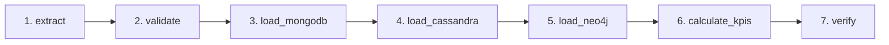
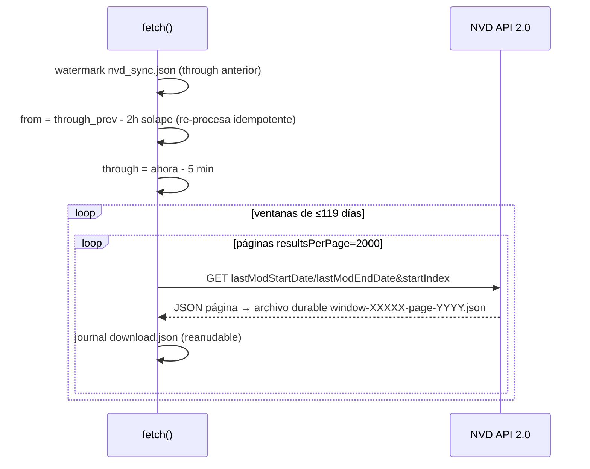

# 04 — Pipeline Airflow y ETL

> **Referencia histórica anterior a la expansión de Cassandra.** Las cifras, pruebas y comandos son de su corte original, no instrucciones vigentes para GCP. Para la arquitectura y operación actuales, consultar [el cierre distribuido](09_distributed_update.md).

## 4.1 El DAG real

**ID**: `nvd_threat_intelligence` · **Archivo**: `airflow/dags/nvd_pipeline.py` (116 líneas)
**Airflow**: 3.4.0 (verificado en metadata 16/11) · **Estado**: activo, 0 import errors, success=10/failed=0.

```python
# Configuración (nvd_pipeline.py:16-35)
schedule="0 3 * * *"        # diario 03:00 UTC
catchup=False
max_active_runs=1, max_active_tasks=1
default_args: retries=2, retry_delay=30s, retry_exponential_backoff=True
params: limit(1000), fail_neo4j_once(False), source_mode("auto"|"local"|"nvd")
```

## 4.2 Las SIETE tareas (confirmadas)



Cadena exacta (`nvd_pipeline.py:111-113`):
`verify(calculate_kpis(load_neo4j(load_cassandra(load_mongodb(validate(extract()))))))`.
XCom transporta **solo la ruta del run_dir**, nunca el dataset.

### 1. extract (`nvd_pipeline.py:37-50`)
Decide la fuente según `source_mode`: en ejecuciones **scheduled** (o modo
`nvd`) llama a `prepare_sync()` → descarga incremental API NVD 2.0; en
manuales usa feeds locales con `limit`. sufijo del run_dir = hash del run_id
(para no colisionar).

### 2. validate → `pipeline.validate()` (`pipeline.py:52-121`)
- Streaming `ijson` por feed/página.
- `normalize(entry)` por registro; inválidos → `quarantine.ndjson` con razón.
- **Dedup** en SQLite temporal (disco contenedor): `INSERT ... ON CONFLICT(id)
  DO UPDATE ... WHERE excluded.modified > records.modified OR (...)` — gana
  la versión con lastModified/hash mayor.
- Emite `canonical.ndjson` ordenado por ID + stats (seen/invalid/duplicates/unique_valid).
- Guarda: si 0 válidos y sync incompleto → error (nunca una carga vacía "exitosa").

### 3-5. loads → `pipeline.load()` (`pipeline.py:141-198`) — uno por motor
Por lote de 200 (`settings().batch_size`):
- `state.changed(engine,row)`: dirty-check contra checkpoint SQLite por (motor,id);
  si hash igual → `unchanged`; si checkpoint más nuevo → `stale`; si no → dirty.
- `sink.write(changed, old_rows)` (ver doc 03 por motor).
- `state.commit(engine, changed)` SOLO tras escritura correcta.
- Recuperación: fallo parcial → repetir; upserts/deletes idempotentes; checkpoint no avanzó.

### 6. calculate_kpis → `pipeline.kpis()` (`pipeline.py:201-239`)
Lee TODA la colección Mongo (proyección sin raw, batch 200), calcula
(`analytics/kpis.py`), añade conteos del grafo, y escribe snapshot en
`kpis.latest` (Mongo) y `kpi_snapshots` (Cassandra) — el mismo JSON.

### 7. verify (`pipeline.py:242-309`) + `commit_sync`
- Huella de los tres motores (ver doc 03 §3.5); desigualdad → ValueError.
- Registra `pipeline_runs` con status SUCCESS.
- `commit_sync()` (`ingestion/sync.py:110-127`) avanza el watermark SOLO si:
  download completa ∧ verify presente ∧ ningún motor FAILED ∧ 0 registros en cuarentena.

## 4.3 Sincronización incremental NVD (`src/threat_intelligence/ingestion/sync.py`)


- Pacing público 6.2s/petición; reintentos con backoff + Retry-After; 6 intentos máximo.
- Páginas son artefactos durables: reanudar tras fallo no re-descarga.
- Watermark comprometido con `through`, `records`, `last_run`.

## 4.4 Incrementalidad, deduplicación, idempotencia (evidencias)

| Propiedad | Mecanismo | Evidencia real |
|---|---|---|
| Dedup intra-run | SQLite ON CONFLICT por lastModified/hash | full34: 171791 seen → 171791 unique, 0 dup (`airflow34_full_manifest.json`) |
| Incremental | checkpoint dirty-check por motor | sync 16/11: 132 vistos, 112 nuevos, 10 modificados, 10 unchanged por MOTOR (`runtime.json`) |
| Idempotencia | upserts + deletes de claves viejas + MERGE | **replay full 10/11: 171791 unchanged, written=0 en los TRES motores** (`airflow34_full_manifest.json:17-48`) |
| No-avance en fallo | checkpoint post-escritura; watermark post-paridad | tests `test_sync.py:32-55` |

## 4.5 Programación, reintentos y errores

- Diario 03:00 UTC, catchup off, una run activa.
- retries=2 por tarea, backoff exponencial desde 30s.
- **Retry real verificado**: run `full34_20261110T212506` → `load_neo4j`
  success con `try_number=2` (`airflow34_scheduler_retry.json:33-35`). El DAG
  incluye un param de prueba `fail_neo4j_once` que inyecta una conexión
  rechazada una sola vez para ejercitar el retry de Airflow.
- Fallo de motor: la tarea fallida se reintenta sola; las demás esperan por
  dependencia serial; el watermark no avanza.

## 4.6 Historial de ejecuciones (metadata consultada 16/11)

| run_id | tipo | estado | duración |
|---|---|---|---|
| scheduled__2026-11-16T03:00 | scheduled | success | 03:00:01–03:02:00 (119s) |
| scheduled__2026-11-15..14..13..12..11 | scheduled | success ×5 | ~110–175s c/u |
| sync34_20261110T215555 | manual | success | 73.6s |
| full34_20261110T212506 | manual (full 171791) | success | ~29 min, idempotente |
| full34_20261110T170841 | manual (replay) | success | 7 etapas, sin duplicar |

Total: **success=10, failed=0, running=0**. Watermark actual:
`through=2026-11-16T02:55:08`, comprometido 03:02:00 tras verify.

## 4.7 Scripts y rutas exactas

| Pieza | Ruta |
|---|---|
| DAG | `airflow/dags/nvd_pipeline.py` |
| Orquestación pipeline | `src/threat_intelligence/pipeline.py` (prepare/validate/load/kpis/verify) |
| Normalización | `src/threat_intelligence/transformations/normalize.py` |
| Sync NVD | `src/threat_intelligence/ingestion/sync.py` |
| Lectura streaming feeds | `src/threat_intelligence/ingestion/nvd.py` |
| Checkpoints | `src/threat_intelligence/incremental/state.py` |
| Adapters | `src/threat_intelligence/databases/{mongodb,cassandra,neo4j}/__init__.py` |
| KPIs | `src/threat_intelligence/analytics/kpis.py` · auditoría: `analytics/audit.py` |
| CLI equivalente | `src/threat_intelligence/cli.py` (run/sync/crud/verify/audit-kpis) |
| Verificador scheduler | `scripts/verify_scheduler3.py` |
| Prueba estructura DAG | `airflow/tests/test_dag_structure.py` |
| Pruebas sync/idempotencia | `tests/test_sync.py` |
| Imagen Airflow | `infrastructure/docker/airflow3.Dockerfile` (ti-airflow:3.4-local, locks propios) |
