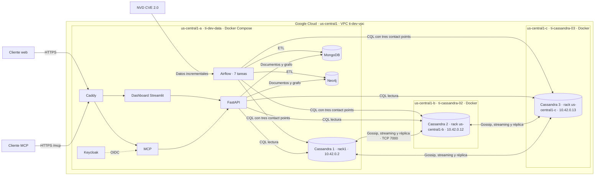

# Cassandra distribuida en Google Cloud

## Antes y topología nueva

La línea base del 17/11/2026 tenía un Cassandra 4.1.9 en `ti-dev-data`: `UN` en `172.18.0.5`, 16 vnodes, ~240 MiB de carga, heap máximo ~755 MiB observado, contenedor de 2 GiB y RF=1. El nombre de clúster `ti-dev-single-node` se conserva como identidad histórica; no indica su número de nodos. El snitch `GossipingPropertyFileSnitch`, el DC `dc1`, `Murmur3Partitioner` y 16 vnodes se conservan. `rack1` se conserva y mapea a `us-central1-a`; los dos racks nuevos se nombran por su zona.

Los nodos son pares; un *seed* solo ayuda a descubrir el anillo. Los nodos nuevos son `e2-standard-2` (2 vCPU/8 GiB), COS con Docker, disco de arranque `pd-standard` de 20 GiB y disco de datos `pd-balanced` de 20 GiB. Heap Cassandra 1 GiB y límite de 3 GiB dejan espacio para caché de páginas y compaction. IP interna reservada, sin IP pública ni cuenta de servicio invitada. La imagen exacta 4.1.9 se transporta por IAP con SHA-256, sin NAT de salida ni credenciales en cada host.

El firewall del proyecto admite 7000 solo entre las tres IP `/32`, 9042 en las réplicas nuevas solo desde `10.42.0.2`, y SSH desde IAP. El nodo 1 escucha CQL en su IP privada. JMX sigue local y se usa con `docker exec ... nodetool`. Cassandra conserva autenticación y autorización; CQL e internodo son tráfico privado sin TLS de aplicación en este despliegue académico. El HTTPS público, Keycloak y los contratos MCP no cambian.

El primer bootstrap no completó gossip: COS tenía `INPUT DROP` aunque el firewall VPC ya aceptaba el tráfico entre VMs. Se comprobó el timeout en sentido nodo 1 → nodo 2 y se instalaron reglas de invitado limitadas a las mismas IP y puertos. El arranque de COS también reinstala esas reglas, sin abrir JMX.

## Replicación y consistencia

**Decisión de cierre (18/11/2026):** conservar `rack1` como etiqueta de `us-central1-a`. Se comprobó la concordancia de configuración y `nodetool` en los tres hosts. El snitch trata los racks como identificadores distintos, no como nombres GCP; hay tres racks para tres zonas y RF=3. Renombrar el rack persistido aporta solo simetría visual y el arranque valida la topología guardada; no se usa un override para forzar el cambio.

`threat_intelligence` y `system_auth` usan `NetworkTopologyStrategy`, `dc1:3`. El segundo cambio es necesario para no perder acceso a roles y permisos al caer su única réplica original. Los demás keyspaces internos se conservan. Con `LOCAL_QUORUM` se requieren dos réplicas sanas para las operaciones normales; las condicionales usan `LOCAL_SERIAL` en la fase Paxos. No se degrada automáticamente a consistencias menores. Un contact point no equivale a una réplica ni a un maestro. La aplicación descubre el anillo, usa balanceo consciente de tokens/DC y reconexión con backoff.

RF=3 sobre tres hosts replica todas las particiones en los tres nodos. Es tolerancia a fallos, **no** tres veces la capacidad útil. Con dos nodos caídos no se promete escritura ni lectura a quorum. La VM principal sigue siendo un punto único de fallo para API, dashboard, MCP, MongoDB, Neo4j y Airflow.

## Operación reproducible y recuperación

1. Revisar `infrastructure/terraform/environments/cassandra-cluster/`. Su estado es **independiente** del entorno `dev`; no importa ni cambia la VM original. Aprovisiona solo dos VMs, dos discos de datos, dos direcciones y tres reglas. Mantener el estado fuera de Git y protegido. Revisar un plan guardado sin reemplazos ni cambios ajenos.
2. Preparar ambos peers con `infrastructure/scripts/cassandra-peer-prepare.sh` y la misma imagen verificada del nodo original. Solo formatea el disco dedicado nuevo si no tiene firmas. No arranca Cassandra ni clona identidades.
3. Ejecutar inventario, pausar DAG y excluir escritores. `scripts/cassandra_cluster_backup.py` guarda configuración/esquema, snapshot con flush, archivo frío, hash, restaura en red `none` y copia a GCS privado. Comparar huella con el inventario antes de autorizar la transición.
4. `infrastructure/scripts/cassandra-primary-cutover.sh` mantiene volumen/host ID, cambia dirección anunciada a privada y usa temporalmente `LOCAL_ONE`. En esta fase, y solo si no arrancó ningún peer, el script puede regresar a configuración anterior sin restaurar datos.
5. Arrancar nodo 2 y esperar `UN` y `Mode: NORMAL` antes de arrancar nodo 3. No incluir al nodo 2 como seed de sí mismo durante su primer arranque. En tres `UN`, ejecutar `scripts/cassandra_cluster_replication.py` con secreto admin montado y verificación del anillo. Reparar completamente aplicación y autenticación antes de activar `LOCAL_QUORUM`; confirmar ausencia de streams y que una segunda verificación no encuentra diferencias. No ejecutar `cleanup`: con RF=3 los tres nodos son propietarios efectivos de todas las particiones.
6. En peers, el archivo `approved` en la raíz del disco dedicado permite a `cassandra-peer-startup.sh` montarlo y arrancar el contenedor al iniciar COS. No crear el archivo antes de validar el bootstrap. La VM principal usa `scripts/cloud_compose.sh`, activado por `secrets/cassandra-cluster.env` (plantilla `infrastructure/cassandra/cluster.env.example`). No ejecutar `docker compose` sin esa selección en GCP.
7. Tras adhesión, volver a una IP Docker no es un rollback válido. Ante un fallo, detener el avance, conservar nodos y volúmenes, y usar el procedimiento nativo de reparación o baja de un peer a la vez con quorum disponible y una ventana comprobada. No usar `removenode`, `assassinate`, reemplazo forzado o borrado de discos como paso automático. Recuperación al estado singleton: cortar escritores, aislar peers, usar **volumen nuevo** de restauración y respaldo verificado, comparar huellas y solo entonces cambiar aplicaciones; si hubo escrituras posteriores al respaldo, reconciliar y reproducir esas ventanas antes de aceptar el cambio. No mezclar el snapshot anterior con un checkpoint/agua posterior sin esa reconciliación.

Sondas: `nodetool status`, `describecluster`, `netstats`, `tablestats`, `compactionstats`; inspeccionar `system_schema.keyspaces` y `/api/v1/analytics/cassandra/snapshot`. Los backups coordinados deben reparar el anillo antes de archivar la copia del nodo 1; una copia de un solo disco sin esa verificación no es respaldo distribuido. Auditar capacidad libre, salud y latencia interzona antes de incrementar el tráfico.

## Costo incremental estimado

Dos VMs × 730 h × USD 0,06701142/h ≈ USD 97,84/mes; 40 GiB `pd-balanced` × USD 0,10 ≈ 4,00; 40 GiB `pd-standard` × USD 0,04 ≈ 1,60. **Aproximadamente USD 103,44/mes**, sin transferencia interzona, almacenamiento GCS extra ni impuestos. No hay NAT ni nuevas IP públicas. Es una estimación basada en el catálogo utilizado por el proyecto, no factura; la reparación y replicación interzona pueden generar tráfico facturable.
