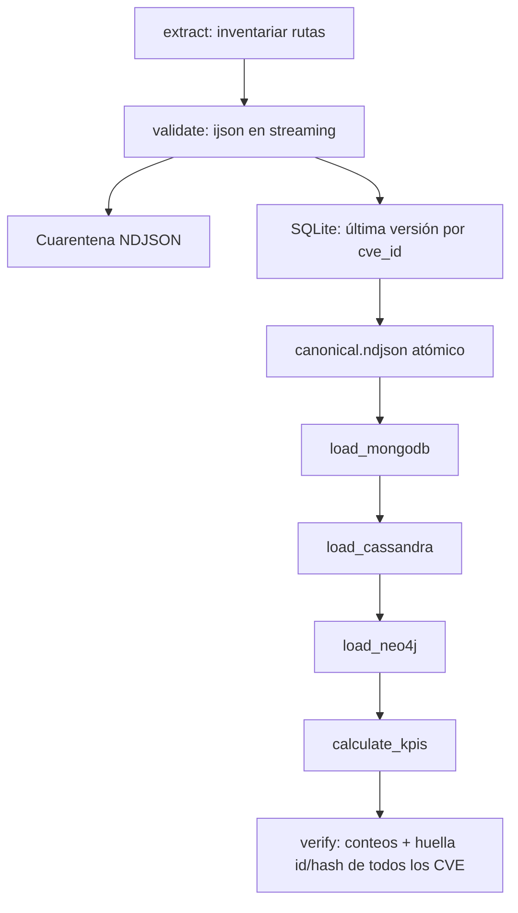

# Flujo, calidad e incrementalidad

1. Extracción referencia archivos locales; no re-descarga. Inventario completo calcula SHA-256 y recuento real.
2. Fechas UTC con microsegundos de longitud fija; ID `CVE-AAAA-NNNN...`. Descripciones inglesas preferidas. Registros inválidos a cuarentena con razón y origen.
3. Deduplicación por `cve_id`: mayor `lastModified`; empate por hash lexicográfico. Un feed incremental nuevo se entrega por `--source` a CLI; DAG relee la carpeta de feeds locales. No hay descarga programada de NVD implementada.
4. Hash SHA-256 de documento normalizado más `raw_cve`, serializado con claves ordenadas. CVSS válido 0–10; NaN/bool/strings se descartan. UNKNOWN se conserva.
5. Cada motor compara `(hash,last_modified)` con su checkpoint. Si no existe, nuevo; mismo hash, sin cambios; hash distinto no anterior, modificado; fecha anterior, obsoleto. `--force` no permite reintroducir versiones anteriores.
6. Cassandra elimina antiguas claves de partición que desaparecieron y escribe nuevas. Neo4j reemplaza solo relaciones salientes del CVE en una transacción; nodos compartidos no se borran. Nodos huérfanos pueden persistir: KPI de nodos es histórico, no número de entidades actualmente afectadas.
7. Checkpoint se confirma tras escritura exitosa del lote. Si una escritura parcial falla, repetir lote es seguro. Tamaño por defecto 200 CVE; Cassandra concurrencia 16. Memoria proporcional al lote/documento y contadores de entidades, no al JSON completo.
8. KPI calculado sobre todos los documentos Mongo, no solo el delta. `verify` compara conteos y suma modular de SHA-256 por `(id,content_hash)` de cada motor. Detecta identidad/contenido divergentes con probabilidad criptográfica; no valida exhaustivamente todas las tablas secundarias o propiedades del grafo.

## Reproducibilidad
`data/staging/<run>/run.json` guarda fuentes, límite, etapas, tiempos y contadores. `canonical.sqlite` deduplica en disco, `canonical.ndjson` alimenta cargas; `quarantine.ndjson` conserva descartados. No transportar documentos por XCom. No repetir `prepare` para reintentar solo una carga: usar subcomando del motor con el mismo run-dir. No ejecutar dos pipelines en paralelo sobre los mismos motores/checkpoints.

Backfill Airflow reprocesa los feeds presentes, no reconstruye snapshots históricos que NVD ya modificó. Para reproducir el pasado se necesitan feeds archivados de esa fecha. Fecha de ejecución no cambia la fecha real de publicación ni la ventana KPI, que usa reloj UTC del cálculo.
