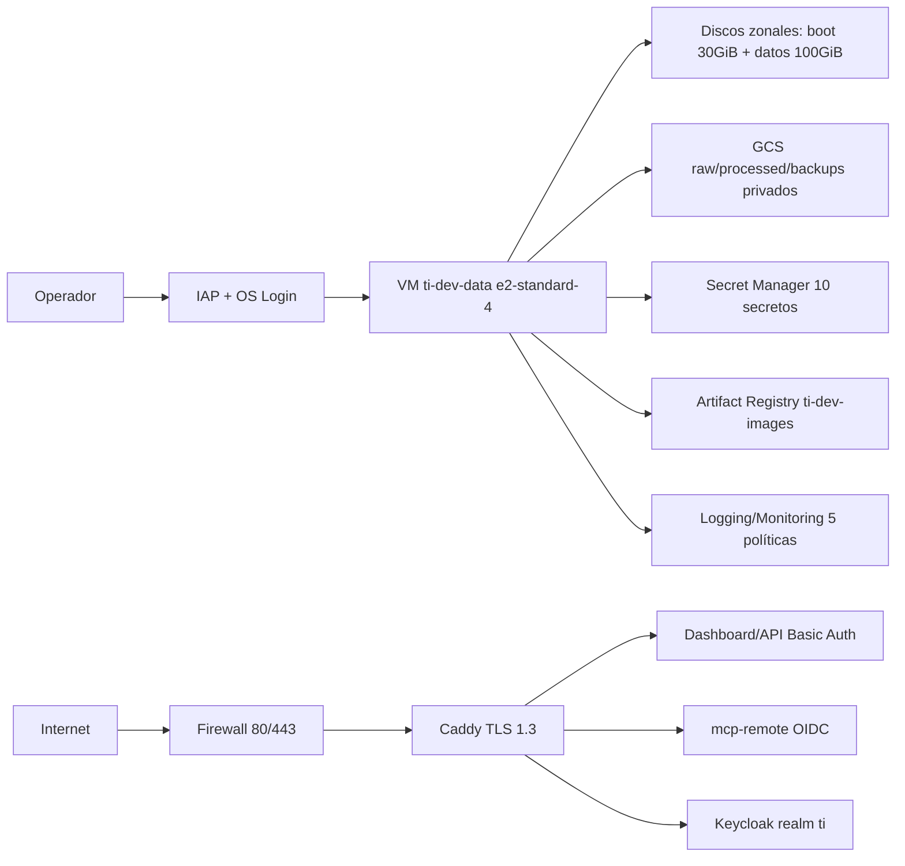

# Arquitectura GCP real — desplegada y verificada

Proyecto `proyectobigdata2-514216`, región us-central1, zona us-central1-a.
Terraform gestiona recursos reales de infraestructura, IAM y observabilidad;
aplicaciones verificadas sobre esa base. Estado privado local; discos con
`prevent_destroy` y VM con protección.

VM ID 1074336130240797471, IP interna 10.42.0.2; IP externa reservada
136.114.21.18 solo para gateway HTTPS/salida (estable para OAuth/DNS,
`ti-136-114-21-18.sslip.io`). No se publican 27017/9042/7687 ni SSH público.
Una sola VM, sin GPU/GKE/CloudRun/NAT/balanceadores.

## Contenedores verificados (13, unidad systemd ti-stack en arranque)
MongoDB 8.0.12 (`mem_limit` 2g), Cassandra 4.1.9 autenticada (`ti_pipeline`/
`ti_reader`, superusuario por defecto deshabilitado), Neo4j 5.26.12, Airflow
3.4 (postgres/api/scheduler/dag-processor, LocalExecutor, serie 1),
API FastAPI, Streamlit, Keycloak 26.8.2 + su PostgreSQL, mcp-remote (OIDC) y
Caddy 2.10.2. Red interna `data` no publica puertos de motores.
Nueve healthchecks Docker nativos; cuatro sondas externas periódicas
(`ti-component-health.timer`) para Caddy/Keycloak/MCP/DAG Processor sin
recreación. Sus cuatro healthchecks nativos se han declarado en Compose,
pero requieren una futura recreación autorizada para aparecer en Docker.

## Datos verificados en cloud
Carga inicial: 171791 CVE por motor, huella `1a60346f...c9fcd2`.
Tras sincronizaciones NVD: **174734 CVE por motor** con paridad de huella
`5d8d4de4...` al cierre v2 (`acceptance_v2/final_state.json`). Sincronización NVD
programada diaria 03:00 UTC (DAG `nvd_threat_intelligence`, watermark
`nvd_sync.json`). Respaldo frío coordinado + subida privada GCS 02:00 UTC
(`ti-backup.timer`); telemetría cada 5 min (`ti-health.timer`).

## Otros recursos
GCS privado raw (feeds NDJSON verificados SHA256) + processed (backups,
lifecycle 7d). Secret Manager sin texto plano en repos/logs. Artifact Registry
`ti-dev-images` con lector+escritor para la SA de la VM; imágenes `ti-app`,
`ti-airflow`, `ti-mcp` publicadas (tags `20261110`/`latest`,
`gcp_image_publish.json`). Observabilidad: 5 políticas de alerta (CPU, memoria,
disco, contenedor no sano, edad de sincronización NVD) + canal de email.

Fuentes: `gcp_vm_created.json`, `gcp_https_validation.json`,
`gcp_services_current.txt`, `gcp_image_publish.json`, `gcp_registry_writer_apply.log`.
No borrar recursos/volúmenes con datos.

Inventario vigente: `docs/evidence/acceptance/gcp_inventory.json`, consultado
por API el 11/11/2026; 10 secretos y 5 políticas, no los conteos anteriores
de 9/7. Cierre de reconstrucción/restauraciones: `docs/report/final_acceptance_v2.md`.
