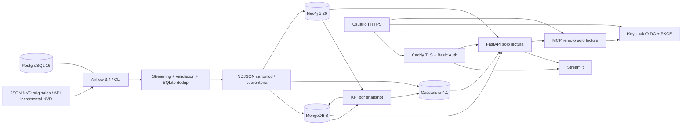

# Arquitectura de la plataforma

> **Vigencia:** el diagrama y la descripción de una VM de esta página corresponden al despliegue inicial. Para GCP actual, usar [la topología de tres VMs](cassandra-gcp-cluster.md).

## Alcance
Plataforma académica desplegada en GCP, una VM e2-standard-4 y un nodo por
motor. No es detección de ataques ni servicio HA. Terraform está aplicado;
el plan de cierre v2 es una comprobación no destructiva, no un nuevo apply.

## Responsabilidades
- MongoDB: verdad documental canónica, original `raw_cve`, KPI y auditoría de ejecuciones verificadas.
- Cassandra: índices analíticos mensuales por severidad/producto/CWE y consulta puntual por CVE; no joins ni `ALLOW FILTERING`.
- Neo4j: identidades y asociaciones CPE/CWE/referencias, no fabricantes inventados ni explotación inferida.
- Airflow: siete tareas seriales, reintentos exponenciales, una ejecución activa, paths pequeños por XCom.
- SQLite: artefacto local de deduplicación y checkpoints por motor; no sustituye ninguno de los tres motores requeridos.
- API/dashboard: lecturas paginadas y snapshots; errores visibles, caché 30 s e invalidación manual.

## Despliegue cloud y seguridad
Red Docker `data` interna, sin puertos publicados de motores. Red `edge` para
presentación: API `127.0.0.1:18000`, dashboard `127.0.0.1:18501`, Airflow 3.4
`127.0.0.1:18081`. La referencia 2.11/18080 se conserva detenida, no recomendada.
Separar edge resuelve acceso sin exponer bases y evita puertos de otros proyectos.
MongoDB, Cassandra y Neo4j autenticados en el runtime cloud con overlay seguro.
El Compose base de desarrollo no equivale al despliegue cloud seguro.
Secret Manager: 10 recursos, materializados solo en el directorio privado de
la VM, con montajes de secretos read-only; no se copian en imágenes.
API Mongo usa `ti_reader` (read), ETL `ti_pipeline` (readWrite de la base);
la credencial admin queda solo en inicialización opt-in. Prueba automatizada
comprueba que el lector puede consultar pero recibe Unauthorized al escribir.
MCP remoto usa la API de solo lectura, no credenciales de motores; endpoint
HTTPS `/mcp`, JWT/OIDC real, seis herramientas. MCP stdio queda como opción
local. El dueño confirmó manualmente una prueba exitosa desde Codex App en
el cierre técnico del16/11. No se atribuye a la suite automatizada ni afirma
una conexión ChatGPT distinta. No se modificaron OAuth ni Keycloak.

Solo Caddy publica 80/443; acceso SSH por IAP. API/dashboard/Airflow escuchan
en loopback de la VM. Las reglas default de otra VPC no se atribuyen a esta VM.
Se usan conjuntamente Compose base + airflow3 + secure + public y el archivo
privado public.env. No publicar el Compose base solo en Internet.

## Operación y verificaciones
13 servicios: MongoDB/Cassandra/Neo4j, API/dashboard, PostgreSQL Airflow,
Airflow API/scheduler/dag-processor, PostgreSQL Keycloak/Keycloak, MCP/Caddy.
Los13 contenedores se observaron running/healthy en la auditoría del16/11;
las cuatro sondas nativas antes pendientes ya estaban activas. Las sondas
externas periódicas se mantienen y no reinician servicios.
Sincronización NVD diaria 03:00 UTC; backup coordinado 02:00 UTC;
5 políticas Monitoring y 10 secretos, ver inventario API de aceptación.
Respaldo conserva volúmenes privados; restauraciones se prueban en volúmenes
scratch, sin red externa y sin montar volúmenes productivos.
Conteos actuales y resultados: [auditoría técnica](../audits/technical_deliverables_audit.md).
El cierre v2 del11/11 conserva evidencia histórica, no los conteos actuales.
El16/11 se verificaron176803 CVE por motor con huella coincidente.

## Reproducción y configuración

Los ocho módulos Terraform y el lockfile pertenecen a Git, incluido el módulo
`modules/secrets` que solo declara recursos/IAM. Ningún state, tfvars privado
o valor de secreto debe acompañarlos. Init/validate desde un export limpio no
crea infraestructura; la reconstrucción de una VM requiere autorización,
inputs privados y restauración por un procedimiento separado. Véase
[Terraform](../../infrastructure/terraform/README.md).

`ti-stack.service` está enabled pero se observó inactive/dead pese a servicios
funcionales; hay que contrastar su ciclo de vida con el backup, no reiniciar la
VM para comprobarlo durante una auditoría. Persistencia actual se acredita por
volúmenes sobre disco de datos, no por un ensayo de reboot nuevo.

## Límites
No transacción distribuida: fallos parciales se recuperan por upserts y checkpoint por sink. No ejecutar CLI/DAG simultáneamente; `max_active_runs=1` solo coordina Airflow. Cambiar manualmente datos o borrar parcialmente un motor requiere reconciliación/`--force`. Restablecer checkpoints sin preservar proyecciones Cassandra puede dejar índices antiguos; para reconstrucción total usar volúmenes nuevos deliberadamente, no borrar a ciegas.
