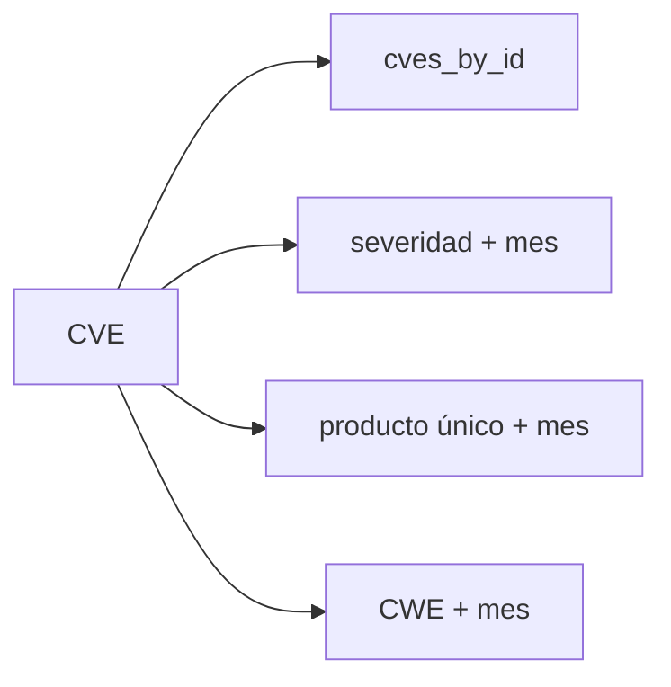

# Apache Cassandra

En GCP: `threat_intelligence` y `system_auth`, NetworkTopologyStrategy `dc1:3`, tres nodos en tres racks; clientes `LOCAL_QUORUM`, LWT con `LOCAL_SERIAL`. En Compose local de desarrollo se conserva RF=1 y `LOCAL_ONE`. IDs de keyspace/DC validados antes de construir CQL. Consultas preparadas y timeout 60 s. [Topología y evidencia](../architecture/cassandra-gcp-cluster.md).

| Tabla | Partition key | Clustering | Consulta |
|---|---|---|---|
| cves_by_id | cve_id | — | Documento canónico sin raw por ID |
| cves_by_severity | (bucket=severity, month) | published DESC,cve_id ASC | Severidad en mes |
| cves_by_product | (bucket=product_id, month) | published DESC,cve_id ASC | Producto en mes |
| cves_by_cwe | (bucket=CWE, month) | published DESC,cve_id ASC | Debilidad en mes |
| kpi_snapshots | snapshot_id | — | Snapshot `latest` |



El mes limita particiones frente a año completo. Filas analíticas contienen descripción truncada a 500 caracteres, score nullable, severidad y claves. Identidad de producto = JSON de `[part,vendor,product]`; versiones CPE no multiplican filas del mismo producto/CVE. Partition sizing es una estrategia, no una medición de bytes de cada partición: revisar distribución/compaction para escalar. En GCP, RF=3 replica los rangos en tres hosts y permite un fallo individual a quorum; no es un aumento de capacidad útil.

Ejemplo CQL sin filtrado:
```sql
SELECT * FROM cves_by_severity WHERE bucket='CRITICAL' AND month='2024-01' LIMIT 25;
SELECT * FROM cves_by_cwe WHERE bucket='CWE-79' AND month='2024-01' LIMIT 25;
```

No contadores acumulativos que se dupliquen con reintentos. `INSERT`/`DELETE` idempotentes; al cambiar severidad/mes/producto/CWE se eliminan claves antiguas guardadas en checkpoint. Operaciones concurrentes 16, no BATCH multpartición gigante. Reintento tras fallo parcial repite escrituras y borrados; checkpoint no avanza si hay error.

El `COUNT(*)` coordinado agotó timeout del servidor en carga completa aunque el cliente permitía120s. Reconciliación cuenta una proyección estrecha `cve_id` con paginación1000, evitando un único agregado de rango. El dashboard consulta snapshots Mongo; Cassandra mantiene proyecciones reales, no se afirma que cada gráfico consulte los tres motores.
