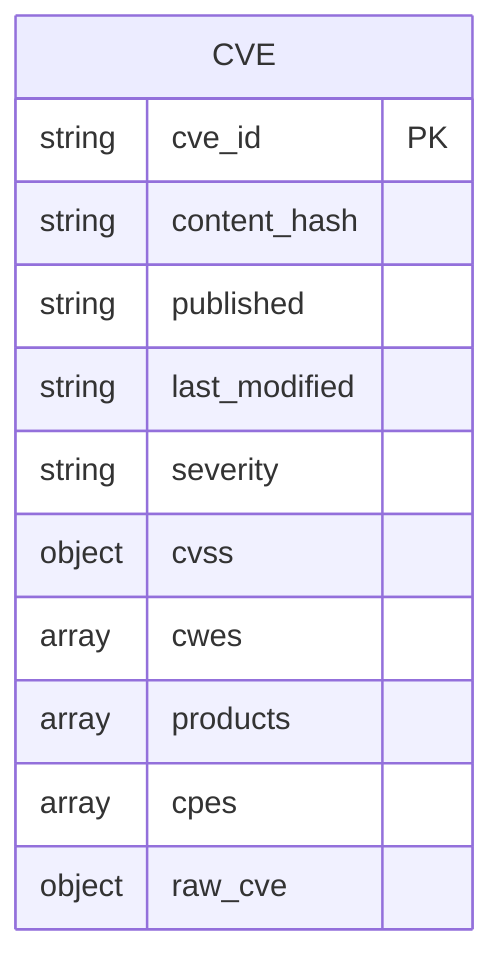

# MongoDB

Base `threat_intelligence`; colecciones `cves`, `kpis`, `pipeline_runs`.
`cves.cve_id` único, validación JSON Schema de campos esenciales y patrón de ID. Índices secundarios: modificación, mes, severidad, CWE, producto. La normalización valida fechas y métricas antes de insertar; no se exige un esquema rígido a `raw_cve`.

Explorer añade compuestos `(year,cve_id)` y `(published,cve_id)` para año/fechas
de **publicación**, tras medir escaneos de ~5.5s. Conteo sin filtro usa hint al
índice único `cve_id_1` para no recorrer documentos grandes. Medición real antes
en `filter_performance.json`; después/pruebas reproducibles con
`scripts/verify_filters.py`. No confundir año publicado con año de ID/feed.

Identidades locales: ETL `ti_pipeline` readWrite en esta base; API `ti_reader`
read. Admin solo inicialización. No se asignan privilegios globales a runtime.

Original CVE completo en `raw_cve`; descripciones, configuraciones, referencias y métricas originales recuperables. Campos canónicos adicionales facilitan consultas. Upsert por `cve_id` con `ReplaceOne`, lotes ordenados. Control de staleness en checkpoint local, no en filtro Mongo: no permitir escritores externos concurrentes.

API filtra por año/severidad/CWE/publicación e ID exacto, ordena por ID, página máxima 10000 y tamaño máximo 100, timeout servidor 10 s. `skip` puede degradarse en páginas profundas; cursor/keyset y compuestos adicionales se dejan para carga superior a esta demostración.

CRUD real: `docker compose run --rm --no-deps runner crud --output docs/evidence/crud.json`. Inserta un ID sintético aleatorio, consulta, actualiza descripción, elimina y comprueba ausencia. No usa IDs reales.
