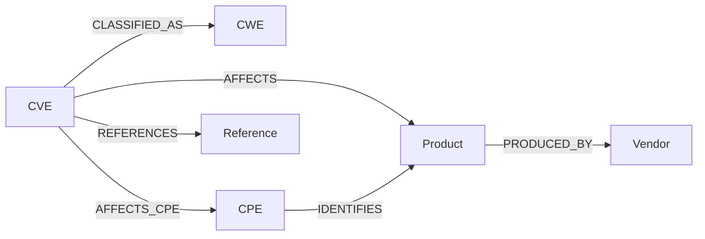

# Neo4j

Constraints únicos: `CVE.id`, `CWE.id`, `Vendor.id`, `Product.id`, `CPE.id`, `Reference.url`.



Solo `cpeMatch.vulnerable == true` con CPE 2.3 válido, fabricante/producto no comodines. Se respetan escapes de separadores CPE. Vendor proviene literalmente de CPE, no verificación corporativa externa. Configuraciones AND/OR completas permanecen en Mongo: una arista no representa por sí sola todos los requisitos de aplicabilidad.

`MERGE` sobre identidades y relaciones. Una transacción por lote borra/reconstruye relaciones salientes de los CVE del lote, conserva entidades compartidas. Las relaciones Product–Vendor y CPE–Product derivan de claves estables. Nodos huérfanos pueden persistir tras una modificación; se documenta al interpretar KPI global del grafo.

```cypher
MATCH (c:CVE {id:$id})-[r]->(n) RETURN c,r,n LIMIT 250;
MATCH (w:CWE)<-[:CLASSIFIED_AS]-(c:CVE)
RETURN w.id,count(c) AS cves ORDER BY cves DESC LIMIT 20;
MATCH (p:Product)<-[:AFFECTS]-(c:CVE)
RETURN p.name,count(c) AS degree ORDER BY degree DESC LIMIT 20;
```

El degree es CVE asociados al producto, no criticidad ni PageRank. No se instaló Graph Data Science ni se afirma haber calculado centralidad avanzada. CRUD usa un CVE sintético aislado y `DETACH DELETE` únicamente para ese ID.
