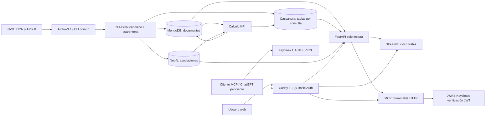
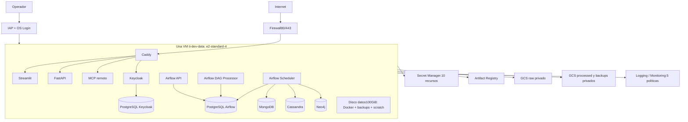
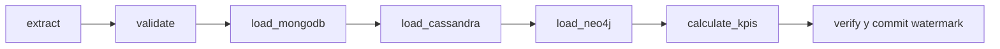
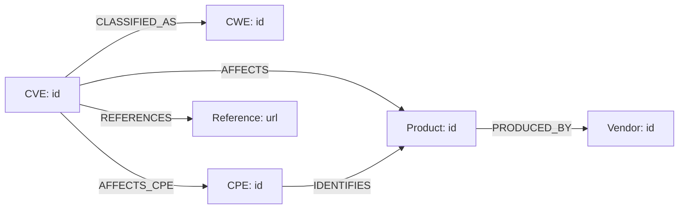
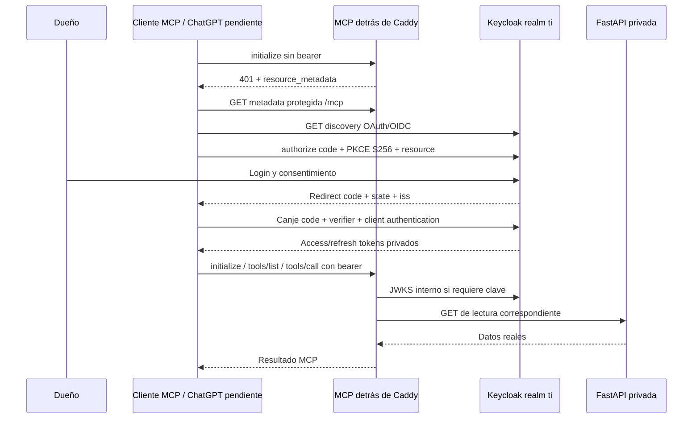

# Big Data II — Threat Intelligence: documentación integral E2E

> **Referencia histórica anterior a la expansión de Cassandra.** Las cifras, pruebas y comandos son de su corte original, no instrucciones vigentes para GCP. Para la arquitectura y operación actuales, consultar [el cierre distribuido](../audits/distributed_final_closure.md).

**Versión documental: 11/11/2026.** Proyecto desplegado en
`proyectobigdata2-514216`, GCP, región `us-central1`.

Este documento describe el código, el despliegue existente y los resultados
ejecutados. No convierte un diseño en una prueba ni una autorización en un
resultado. El cierre de aceptación de referencia es
[`final_acceptance_v2.md`](final_acceptance_v2.md). La conexión del dueño a
ChatGPT se detalla en
[`chatgpt_mcp_setup.md`](../integrations/chatgpt_mcp_setup.md).

## Cómo leer las evidencias

- **Implementado:** existe en los archivos que se citan; no implica que todas
  las variantes de configuración o errores se hayan ensayado.
- **Verificado:** hay una ejecución real, fecha y artefacto identificables.
- **Pendiente / límite:** no se ejecutó o depende de permisos/cuenta del dueño.
- Rutas `acceptance_v2/`, `integration_setup/` y `acceptance/` en las tablas
  corresponden a subdirectorios de `docs/evidence/`.
- La documentación actual añadió pruebas de lectura HTTPS, discovery,
  configuración OAuth runtime, refresh, protocolo y herramientas MCP. No
  repitió las operaciones CRUD/restauraciones de v2 ni un apply de Terraform.

### Estado comprobado por corte

| Corte | CVE únicos por motor | Significado y evidencia |
|---|---:|---|
| Dataset/carga inicial | 171791 | Tres archivos anuales originales; carga local y cloud inicial. `inventory.json`, `gcp_initial_load_recovery.log`. |
| Después de sync34 del10/11 | 174607 | Estado almacenado en el respaldo del11/11 02:00; se restauró desde GCS en los tres motores. `acceptance_v2/restore_three.json`. |
| Después de la programada11/11 03:00 | **174734** | Escaneo completo,0 IDs duplicados y misma huella en MongoDB/Cassandra/Neo4j. `acceptance_v2/final_state.json`. |
| Consulta MCP nueva11/11 07:18 UTC | **174734** | Snapshot `as_of=2026-11-11T03:01:47.586892+00:00`; seis herramientas ejecutadas. `integration_setup/tools_execution.json`. |

La diferencia entre respaldo y producción es esperada: el respaldo precede
la sincronización diaria. No representa pérdida de127 registros al restaurar.

## Índice

1. Objetivo, problemática, origen y requisitos académicos.
2. Dataset NIST NVD y actualización incremental.
3. Arquitectura completa y componentes.
4. Pipeline Airflow3.4: siete etapas.
5. Modelos MongoDB, Cassandra y Neo4j.
6. Flujo E2E, recuperación e integridad entre motores.
7. KPI: fórmulas, consultas y resultados.
8. Backend FastAPI.
9. Dashboard Streamlit.
10. MCP, OAuth y ChatGPT.
11. Infraestructura GCP y Terraform.
12. Seguridad, respaldos y restauración.
13. Pruebas y resultados reales.
14. Costos, operación y mantenimiento.
15. Estructura y procedimientos de reproducción.
16. Limitaciones, pendientes y conclusiones.

## 1. Objetivo, problemática, origen y requisitos académicos

### 1.1 Qué problema resuelve

NVD publica vulnerabilidades en documentos JSON con descripciones, métricas,
debilidades, configuraciones de productos y referencias. Leer manualmente
archivos de más de1GB no permite consultar con facilidad cambios, severidad,
productos, debilidades y relaciones. Además, un mismo CVE puede modificarse
después de su publicación: no basta con insertar una vez y contar filas.

La solución transforma esos documentos en una representación común y la
persiste en tres modelos complementarios. Un dashboard y una API permiten
consultar los resultados; MCP expone una interfaz de herramientas para clientes
como ChatGPT. Airflow coordina la carga y la actualización automática.

**No es** un scanner, SIEM, detector de ataques, inventario de activos de una
empresa ni una prueba de explotación. Un CVE describe una vulnerabilidad;
una relación `AFFECTS` describe asociación extraída de NVD, no evidencia de
que una organización fue atacada.

### 1.2 Por qué es un proyecto de Big Data académico

- **Volumen:** 1117082537 bytes originales,171791 entradas; lectura streaming,
  lotes y persistencia real, no un DataFrame íntegro como almacenamiento.
- **Variedad:** objetos anidados, arrays, versiones de CVSS, CPE, CWE y URLs.
- **Variabilidad:** cambios de CVE, campos ausentes, diferencias de fecha y
  actualizaciones fuera del año indicado en el identificador.
- **Veracidad:** validación, cuarentena, deduplicación y conciliación por huella.
- **Valor:** preguntas analíticas reproducibles y asociaciones de grafo.

La escala es académica y no se presenta como una plataforma industrial
distribuida de petabytes. Los tres motores comparten una VM; la aportación es
el diseño poliglota, la recuperación e incrementalidad, no tolerancia HA.

### 1.3 Requisitos y evolución real

La matriz `docs/implementation/requirements.md` contiene17 criterios:
dataset, tres motores, DAG, incrementalidad, CRUD, al menos cinco KPI,
dashboard, pruebas, Docker, Terraform, costos, informe, guion, evidencias y
trazabilidad. V2 acredita17/17 en su alcance funcional/documental; no incluye
publicación en un directorio de OpenAI ni reconstrucción de una VM vacía.

Evolución documentada, sin mezclar etapas:

1. Carga local de los tres feeds y adaptación de modelos, KPI y consultas.
2. Recuperación de cargas parciales con checkpoints. El conteo Cassandra se
   cambió de agregado `COUNT(*)` a lectura paginada por problemas del coordinador.
3. SQLite temporal en disco del contenedor para evitar I/O aleatorio lento
   sobre bind mounts Windows.
4. Migración al runtime recomendado Airflow3.4, dejando aislada la referencia
   anterior2.11 y sus datos. No se presenta2.11 como runtime cloud actual.
5. Despliegue autorizado en una VM GCP; MongoDB necesitó2GiB de límite tras un
   OOM en carga. Se reanudó sin volver a descargar feeds válidos.
6. HTTPS, Keycloak/OIDC y MCP remoto; mapper de `sub` y orden de rutas de Caddy
   corregidos durante el despliegue y luego verificados.
7. Sync NVD real, replays, CRUD y restauraciones aisladas. V2 corrigió además
   inventarios de alertas/secretos y separó salud nativa de sondas externas.

Fuentes: `docs/implementation/decisions.md`, `cloud_execution.md`,
`docs/evidence/gcp_deployment.md` y los cierres de aceptación. Los incidentes
y primeros fallos se conservan, no se reinterpretan como pruebas exitosas.

## 2. Dataset NIST NVD y actualización incremental

### 2.1 Fuente e inventario original

Los datos son NVD CVE2.0. La aplicación consume archivos JSON originales y,
para actualización cloud, la API
`https://services.nvd.nist.gov/rest/json/cves/2.0`.

| Archivo relativo | Bytes | Entradas originales |
|---|---:|---:|
| `data/raw/nvd/2024/nvdcve-2.0-2024.json` | 293745058 | 39369 |
| `data/raw/nvd/2025/nvdcve-2.0-2025.json` | 295852585 | 45482 |
| `data/raw/nvd/2026/nvdcve-2.0-2026.json` | 527484894 | 86940 |
| Total | **1117082537** | **171791** |

`docs/evidence/inventory.json` registra tamaños, SHA256 y metadata de cada
archivo; sus timestamps corresponden al09/11/2026. Esto es inventario de
entrada, no una afirmación de que el almacén incremental seguirá teniendo
siempre ese número.

### 2.2 Estructura JSON y significado

La ruta de lectura es `vulnerabilities.item`, mediante `ijson`, en
`src/threat_intelligence/ingestion/nvd.py`. El archivo tiene metadata superior
como `format`, `version`, `resultsPerPage`, `startIndex`, `totalResults` y
`timestamp`; cada elemento contiene un objeto `cve`.

| Ruta de origen | Uso |
|---|---|
| `cve.id` | Identidad CVE, validada con expresión regular. |
| `published`, `lastModified` | Fechas de publicación/cambio; normalización UTC. |
| `descriptions[]` | Descripción inglesa preferida; fallback a otra disponible. |
| `metrics.cvssMetricV40/V31/V30/V2` | Selección de una métrica preferida válida. |
| `weaknesses[].description[]` | CWE válidas, únicas y ordenadas. |
| `configurations` con `nodes`/`children`/`cpeMatch` | Extracción recursiva de CPE vulnerables y productos. |
| `references[].url` | Referencias únicas; no se ejecuta su contenido. |
| `vulnStatus` | Estado; `Rejected` no se confunde con registro inválido. |

Proyección mínima **real** devuelta por el MCP para el ejemplo de prueba:

```json
{
  "cve_id": "CVE-2020-9709",
  "published": "2026-11-05T16:17:04.180000+00:00",
  "last_modified": "2026-11-10T19:17:36.013000+00:00",
  "year": 2026,
  "month": "2026-11",
  "status": "Awaiting Analysis",
  "severity": "HIGH",
  "cwes": ["CWE-269"],
  "products": []
}
```

Es una proyección canónica, no el feed completo ni un CVE ficticio. El año
`2020` del ID no determina `year=2026`: este último se deriva de `published`.
La lista vacía de productos se conserva; no se inventa una asociación.

### 2.3 Normalización y calidad

`transformations/normalize.py` produce:
`cve_id`, `published`, `last_modified`, `month`, `year`, `status`, `description`,
`cvss`, `severity`, `cwes`, `products`, `cpes`, `references`, `raw_cve` y
`content_hash`.

- Fechas con precisión de microsegundos y zona UTC; una fecha sin zona se
  interpreta como UTC.
- CVSS preferido4.0 →3.1 →3.0 →2.0. Dentro de cada familia se prefiere
  `Primary` y se usa orden estable por fuente. Se rechazan scores booleanos,
  no finitos o fuera de0–10; se infiere severidad si falta.
- Sin score válido: `cvss=null`, severidad `UNKNOWN`, no0.
- CWE: solo patrón `CWE-<número>`; etiquetas como NVD-CWE-noinfo no pasan como CWE.
- CPE: parser que respeta dos puntos escapados, formato2.3 y13 componentes.
  Solo `vulnerable=true` y vendor/product concretos; no convertir comodines
  en productos conocidos.
- Producto: identidad JSON estable de `[part,vendor,product]`; una versión
  CPE no cuenta como otro producto.
- SHA256 sobre JSON canónico ordenado, compacto y UTF-8, antes de añadir el
  propio hash. Incluye el original `raw_cve`; cambios de origen pueden cambiar
  el hash aunque no se vean en un gráfico.

La validación escribe `quarantine.ndjson` para entradas inválidas y usa
SQLite temporal con PK por ID para deduplicar. Gana el `lastModified` más
nuevo; a igualdad de fecha, el mayor hash en orden lexicográfico estabiliza
el resultado dentro de esa entrada/run. `canonical.ndjson` se publica mediante
archivo temporal y reemplazo; `canonical.sqlite` queda como artefacto.

### 2.4 Descarga incremental NVD

`ingestion/sync.py` implementa una ventana de modificaciones, no una descarga
anual completa diaria:

1. `until = ahoraUTC - 5min`, para no pedir el borde más reciente.
2. Sin watermark, ventana inicial de2d; con watermark,
   `since = through_anterior - 2h`, solape deliberado.
3. División en ventanas de hasta119d; páginas de2000 entradas.
4. Espera6.2s antes de cada request, incluso con API key opcional.
5. Hasta6 intentos por página para errores de red/timeout,429 y5xx
   seleccionados, backoff y `Retry-After` numérico acotado.
6. Validación de `startIndex`, `totalResults` y listas; una página vacía
   prematura no se acepta como final correcto.
7. Páginas y journal durables; una página ya guardada se reutiliza en el
   mismo run. No se sobrescriben los feeds anuales válidos.
8. `nvd_sync.json` avanza únicamente después del `verify` de paridad y sin
   inválidos pendientes en la validación.

El solape añade lecturas, no CVE duplicados: el checkpoint por motor detecta
hashes iguales. No hay garantía de capturar cualquier cambio arbitrariamente
atrasado fuera de la ventana; requeriría backfill y revisión operativa.

## 3. Arquitectura completa y componentes

### 3.1 Vista lógica



La API es la frontera de lectura compartida. MCP no recibe contraseñas de
Mongo/Cassandra/Neo4j, ni deja elegir una URL de API en los argumentos.
Streamlit tampoco escribe en las bases. El componente que sincroniza es
Airflow/CLI, no el dashboard ni una herramienta de ChatGPT.

### 3.2 Vista desplegada



Los13 nodos de servicio del diagrama son contenedores del stack, no13 VMs.
El disco de arranque es de30GiB; los datos Docker se trasladaron al de100GiB.
PostgreSQL soporta metadatos e identidad, no sustituye ninguno de los tres
motores académicos. SQLite es un estado auxiliar de ETL, no un cuarto motor
analítico presentado como requisito.

## 4. Pipeline ETL de Airflow3.4 y siete etapas

Definición: `airflow/dags/nvd_pipeline.py`; código común:
`src/threat_intelligence/pipeline.py`. LocalExecutor, schedule `0 3 * * *`,
zona UTC, `catchup=False`, una ejecución y una tarea activa por DAG.
Cada tarea tiene2 reintentos, espera inicial30s y backoff exponencial.



| Etapa | Trabajo real | Salida / condición de éxito |
|---|---|---|
| `extract` | Decide modo y prepara fuentes; programada con auto usa NVD API. Manual con auto usa archivos locales. | Ruta de run y `run.json`; en NVD, páginas/journal completos. |
| `validate` | Streaming, normalización, dedup y cuarentena. | `canonical.ndjson`, SQLite y estadísticas; carga vacía local no es éxito. |
| `load_mongodb` | Compara checkpoint propio y upsert de documentos nuevos/modificados. | Lotes confirmados antes de guardar checkpoint. |
| `load_cassandra` | Upsert por ID y proyecciones; borra claves antiguas que ya no aplican. | Todas las operaciones del lote completadas; si hay fallo no avanza ese checkpoint. |
| `load_neo4j` | MERGE de entidades y reconstrucción de aristas salientes de CVE cambiados. | Transacción de lote confirmada; reintento real disponible en ensayo. |
| `calculate_kpis` | Lee población de Mongo y conteos del grafo; guarda snapshots Mongo/Cassandra. | `kpis.json`, colección `kpis` y tabla `kpi_snapshots`. |
| `verify` | Escanea IDs/hashes de tres motores, compara conteo/huella y registra run verificado; después intenta commit NVD. | Paridad; watermark solo si download/cargas completos y sin inválidos. |

Solo viajan **rutas** por XCom; los documentos permanecen en staging. El
directorio se identifica con `sha256(run_id)[:20]`, evitando que nombres de
run se conviertan en rutas arbitrarias.

Parámetros:

- `source_mode`: `auto`, `local` o `nvd`; los runs programados auto usan NVD.
- `limit`: default1000 para archivos locales;0 significa completo, no vacío.
  `prepare_sync` fuerza el conjunto descargado completo, no ese límite local.
- `fail_neo4j_once`: defaultfalse; ensayo opt-in que produce una conexión
  rechazada real y permite observar el segundo intento. No está activo en
  los runs normales.

Última programada de v2: `scheduled__2026-11-11T03:00:00+00:00`, inicio
03:00:46.465455 UTC, fin03:02:32.301134 UTC,105.835679s; las siete tareas
SUCCESS, intento1. El retraso se contextualiza con la coordinación del restore;
no se manipularon estados para fabricar un éxito. El DAG quedó activo al final.

## 5. Modelos y justificación de MongoDB, Cassandra y Neo4j

### 5.1 MongoDB: verdad documental y snapshots

Implementación: `databases/mongodb/__init__.py`. Base
`threat_intelligence`, colección principal `cves`. Se conserva el documento
canónico y `raw_cve` para trazabilidad, evitando perder configuraciones NVD
que el modelo simplificado no interpreta completamente.

| Elemento | Implementación |
|---|---|
| Identidad | `cve_id`; índice único `cve_id_1`. |
| Validador al inicializar | Campos requeridos `cve_id`, `content_hash`, `published`, `last_modified`; patrón CVE. |
| Índices simples | `last_modified`, `month`, `severity`, `cwes`, `products.id`. |
| Índices compuestos | `(year,cve_id)` y `(published,cve_id)` para el explorador. |
| Escritura | `bulk_write` de `ReplaceOne({cve_id:...},row,upsert=True)`, ordenado por lote. |
| Otras colecciones | `kpis` con `_id=latest`; `pipeline_runs` para runs verificados. |

Mongo encaja con documentos de estructura variable y consulta puntual. No se
utiliza `_id` aleatorio como identidad de negocio del CVE. Reemplazar por ID
mantiene un documento vigente; no hay versionado automático de cada cambio.

Consultas de lectura correspondientes al modelo —son ejemplos de operación,
no resultados nuevos de una consola ejecutada para este documento—:

```javascript
db.cves.findOne({cve_id: "CVE-2020-9709"}, {_id: 0, raw_cve: 0})
db.cves.find({severity: "CRITICAL", year: 2026}, {_id: 0, raw_cve: 0})
  .sort({cve_id: 1}).limit(5)
db.cves.aggregate([{$group: {_id: "$severity", n: {$sum: 1}}}])
```

### 5.2 Cassandra: desnormalización por consulta

Implementación: `databases/cassandra/__init__.py`; keyspace
`threat_intelligence`, `NetworkTopologyStrategy`, RF1 en `dc1` en el
entorno académico. RF1 no es redundancia ni alta disponibilidad.

| Tabla | Clave | Consulta prevista |
|---|---|---|
| `cves_by_id` | `PRIMARY KEY(cve_id)` | Hash y documento/proyección canónica por ID. |
| `cves_by_severity` | `PRIMARY KEY((bucket,month),published,cve_id)` | CVE de una severidad y mes. |
| `cves_by_product` | Misma forma; bucket es identidad JSON del producto | Vulnerabilidades de producto/mes. |
| `cves_by_cwe` | Misma forma; bucket es CWE | Vulnerabilidades de debilidad/mes. |
| `kpi_snapshots` | `PRIMARY KEY(snapshot_id)` | Snapshot JSON `latest` consultado directamente por la API. |

Las tres proyecciones ordenan publicación descendente e ID ascendente.
Se particiona por mes para no crear una única partición de todas las
vulnerabilidades críticas de todos los años. Las consultas no dependen de
joins ni `ALLOW FILTERING`.

```sql
SELECT cve_id, severity, score
FROM threat_intelligence.cves_by_severity
WHERE bucket='CRITICAL' AND month='2026-11' LIMIT 5;

SELECT payload FROM threat_intelligence.kpi_snapshots
WHERE snapshot_id='latest';
```

El documento Cassandra excluye `raw_cve`. La descripción de las tablas
analíticas se acota a500 caracteres. Las sentencias se preparan; la escritura
usa concurrencia16. Si cambia severidad, producto, mes o CWE, se compara la
proyección anterior y se eliminan las claves que ya no corresponden. Un
upsert por ID por sí solo no limpiaría esos índices secundarios.

El conteo operativo recorre IDs con `fetch_size=1000`, evitando el agregado
global que ya produjo timeout del coordinador. Esto sigue siendo un escaneo
de costo proporcional a la población, no una consulta O(1).

### 5.3 Neo4j: relaciones explícitas

Implementación: `databases/neo4j/__init__.py`.



Constraints únicos: `CVE.id`, `CWE.id`, `Product.id`, `Vendor.id`, `CPE.id` y
`Reference.url`. Se usa `MERGE` para entidades compartidas; el campo `raw_cve`
no se duplica en el grafo. Para CVE modificados, la transacción elimina sus
aristas salientes anteriores y crea las actuales. Los nodos compartidos o
huérfanos no se purgan automáticamente: eliminarlos indiscriminadamente
podría afectar otras vulnerabilidades.

```cypher
MATCH (c:CVE {id:$id}) OPTIONAL MATCH (c)-[r]->(n)
RETURN c.id AS cve_id, type(r) AS relationship,
       labels(n) AS labels, properties(n) AS entity
LIMIT 250
```

El ID se pasa como parámetro, no concatenando Cypher del usuario. En el
corte actual del snapshot hay627477 nodos y1488730 relaciones, pero solo
174734 nodos CVE: **nodos totales no equivalen a vulnerabilidades**.

## 6. Flujo E2E, consistencia y recuperación

### 6.1 Recorrido de un cambio

1. NVD aporta un CVE nuevo/modificado dentro de la ventana.
2. La página se guarda antes de continuar; el journal permite reanudar.
3. La normalización produce el mismo contrato para los tres motores.
4. SQLite dedup elige una fila por ID en el run; se publica NDJSON ordenado.
5. Cada sink consulta su propio checkpoint `(sink,id)` y decide escribir.
6. El motor confirma el lote; solo entonces se confirma su estado local.
7. KPI se recalculan y se publican snapshots con `as_of`.
8. `verify` concilia identidad/contenido y registra la ejecución; el watermark
   NVD se actualiza después y solo si se cumplen sus condiciones.
9. API y dashboard consultan datos persistidos; MCP llama a esa API.

### 6.2 Qué representa el checkpoint

`incremental/state.py` usa SQLite WAL, con columnas
`sink,id,hash,modified,projection` y PK `(sink,id)`. La proyección conserva
los campos necesarios para retirar claves Cassandra antiguas sin guardar
todo el documento original otra vez.

```python
# Semántica del código real, resumida:
if old and old.modified > incoming.last_modified:
    return "stale"      # no regresar a una versión de fecha anterior
if not old:
    return "new"
if old.hash == incoming.content_hash and not force:
    return "unchanged"
return "modified"
```

`force` o un motor vacío fuerza recarga, pero no anula la protección de fecha
anterior implementada antes de esa decisión. A igualdad de fecha y hash
distinto se trata como cambio; no se promete una resolución distribuida de
todas las ambigüedades de origen.

### 6.3 Huella y alcance de la garantía

Para cada motor se calcula, además del total:

```text
sum(SHA256(cve_id + ':' + content_hash), interpretado como entero)
mod 2^256
```

Es una huella multiconjunto independiente del orden, no el SHA256 de un
archivo exportado ni una firma criptográfica del dataset. Confronta todos
los pares ID/hash, no solo una muestra. V2 comprobó también IDs únicos.
Huella actual común:
`5d8d4de4bebf0d1cb4251cc7e7cc8c0e12fa255e13146ac5bd796e28581d02b1`.

Esto detecta divergencia de identidad/contenido canónico. **No demuestra por
sí solo cada arista Neo4j ni cada fila de proyección Cassandra**. Hay pruebas
adicionales de consultas, CRUD, KPI y relaciones, con esa cobertura declarada.
La conciliación usa el `content_hash` guardado, no vuelve a serializar todo el
payload de cada motor para recalcularlo. Una alteración externa que deje un
hash desactualizado podría no detectarse con este mecanismo por sí solo.

No existe transacción distribuida entre los tres motores ni rollback global.
Un fallo deja checkpoints distintos; el replay vuelve a aplicar lo necesario.
La serie Airflow reduce concurrencia entre sus runs, pero **no bloquea una
CLI externa**: un pipeline a la vez sigue siendo regla operativa.

KPI se escribe antes de `verify`; no es una publicación atómica global. Si
una verificación final falla, el operador debe revisar el run y los snapshots,
no considerar cualquier respuesta200 de la API prueba de cierre E2E.

## 7. KPI: fórmulas, consultas y resultados

Código: `analytics/kpis.py`; comprobaciones: `analytics/audit.py` y
`docs/evidence/acceptance_v2/quality.json`. Se lee Mongo en batches200 sin
`raw_cve` y se acumulan contadores; el grafo aporta totales por consulta.

Sea `N` la población de documentos CVE del snapshot y `t=as_of`:

| Indicador | Fórmula / interpretación | Resultado al snapshot03:01:47 UTC |
|---|---|---:|
| CVE únicos | Conteo de la colección con índice único | **174734** |
| Críticos | Conteo con severidad CRITICAL | **17894** |
| Altos | Severidad HIGH | 64615 |
| Medios | Severidad MEDIUM | 74203 |
| Bajos | Severidad LOW | 10115 |
| Sin score | UNKNOWN, no imputar0 | 7828 |
| NONE | Severidad NONE | 79 |
| Porcentaje crítico | `round(100 * critical/N,4)` | **10.2407%** |
| Rejected | Estado original igual a Rejected; incluidos en N | **4019** |
| Cambios30d | `t-30d <= last_modified <= t`, inclusive | **59011** |
| Productos únicos | Cardinalidad de identidades `[part,vendor,product]` | **23082** |
| Nodos / relaciones | Conteo global Neo4j | 627477 /1488730 |

CVSS se promedia **por versión de la métrica seleccionada**, no mezclando
versiones ni suponiendo que todo CVE tiene score:

| Versión | N con esa versión seleccionada | Media redondeada4 decimales |
|---|---:|---:|
| 3.1 | 121906 | 6.9193 |
| 4.0 | 43602 | 6.2432 |
| 3.0 | 1398 | 7.3237 |

No aparece una fila2.0 en este snapshot porque no hay observaciones con esa
versión seleccionada en el resultado, no porque se haya inventado media0.
Publicaciones mensuales se agrupan por `published[:7]`, no por cambios ni
por año del CVE. Rankings CWE/producto/vendor cuentan cada entidad una vez
por CVE usando conjuntos, y devuelven los20 primeros.

Resultados nuevos consultados por MCP:

- CWE-79:22861 CVE; CWE-89:10249; CWE-862:8869.
- Producto `["o","linux","linux_kernel"]`:8140; `["a","google","chrome"]`:4337.

Ejemplos de conciliación independiente usados en el cierre:

```javascript
db.cves.countDocuments({status: "Rejected"})
db.cves.aggregate([{$group: {_id: "$month", n: {$sum: 1}}}])
db.cves.aggregate([
  {$unwind: "$products"}, {$group: {_id: "$products.id"}}, {$count: "n"}
])
```

Seis checks independientes coincidieron: total, severidad, meses, Rejected,
productos únicos y cambios30d. El snapshot vive en Mongo `kpis/latest`,
Cassandra `kpi_snapshots/latest` y `kpis.json` del run. No hay un historial
temporal completo en la clave `latest`: consultar un snapshot no equivale a
analítica histórica de cualquier fecha.

## 8. Backend FastAPI

Implementación: `services/api/app.py`; título `Threat Intelligence Platform`,
**versión de aplicación1.0**, distinta de la versión de la biblioteca FastAPI
y del paquete Python del proyecto0.1.0.

El lifespan mantiene clientes Mongo/Neo4j y los cierra al salir. Cassandra
se abre/cierra en los endpoints que la necesitan con
`initialize_schema=False`; las lecturas no deben crear tablas/keyspaces.
La API no expone rutas de escritura de CVE.

| Método y ruta | Fuente / comportamiento |
|---|---|
| GET `/health` | Liveness del proceso, `{"status":"ok"}`; no prueba todos los motores. |
| GET `/ready` | Ping Mongo, Neo4j y Cassandra; resultado ready solo si responden. |
| GET `/api/v1/kpis` | Mongo, snapshot `latest`;404 si falta. |
| GET `/api/v1/vulnerabilities` | Mongo, filtros y paginación. |
| GET `/api/v1/vulnerabilities/{cve_id}` | Documento completo canónico/raw;404 si falta. |
| GET `/api/v1/cwes/top` | Ranking del snapshot Mongo. |
| GET `/api/v1/products/top` | Ranking del snapshot Mongo. |
| GET `/api/v1/analytics/cassandra/snapshot` | SELECT real a Cassandra, no respuesta Mongo etiquetada como Cassandra. |
| GET `/api/v1/graph/cve/{cve_id}` | Cypher parametrizado, máximo250 relaciones salientes. |
| GET `/api/v1/pipeline/status` | Manifiesto de staging más reciente; fallback al run verificado Mongo. |
| GET `/docs`, `/openapi.json`, `/redoc` | Documentación/esquema de FastAPI; protegidos en público por Caddy. |

Filtros de listado: `cve_id`, `year`1999–2100, `severity`, `cwe`,
`published_from`, `published_to`, `page`1–10000, `page_size`1–100. Un rango
invertido devuelve422. El final de fecha incluye todo el día. La consulta
ordena por ID, limita tiempos a10s y usa el índice de ID para conteo sin filtros.
No es búsqueda textual libre: pasar una descripción en `cve_id` no está soportado.

Ejemplos de rutas —en público requieren Basic Auth del dueño, no la
credencial OAuth de MCP—:

```text
GET /api/v1/vulnerabilities?severity=CRITICAL&year=2026&page=1&page_size=5
GET /api/v1/vulnerabilities/CVE-2020-9709
GET /api/v1/graph/cve/CVE-2020-9709
```

Los errores generales se traducen a503 con mensaje sin detalles de BD; el
log guarda el tipo de error, no la contraseña. Los path parameters de
detalle/grafo no tienen el mismo validador declarativo que el filtro de
listado; aun así, las consultas usan igualdad/parametrización. No se afirma
que cada entrada de la API tenga validación idéntica a los schemas MCP.

`IN_PROGRESS_OR_INTERRUPTED` en pipeline/status significa que el manifiesto
no contiene cierre verificable: **no prueba que exista un proceso vivo**.
La verdad de scheduling se comprueba en los metadatos Airflow por separado.

## 9. Dashboard Streamlit y cinco vistas

Implementación: `services/dashboard/app.py`. API configurable por operador,
`st.cache_data(ttl=30)`, botón de invalidación manual. No consulta secretos
de motores ni sustituye errores por cifras simuladas.

| Vista | Comportamiento |
|---|---|
| Overview | Total, críticos, cambios30d, productos, medias CVSS por versión, severidad y publicaciones mensuales. Muestra fecha de snapshot. |
| Vulnerability Explorer | Formulario de ID/año/severidad/CWE/fechas,25 filas por página y detalle seleccionable. El selector de año de UI ofrece2024–2026; la API admite un rango mayor. |
| Threat Analytics | Rankings y snapshot consultado directamente en Cassandra; avisa si su `as_of` difiere de Mongo. Los rankings mostrados proceden del snapshot Mongo. |
| Graph Intelligence | Consulta explícita al pulsar Explorar relaciones; tabla y DOT/Graphviz real, máximo250 salientes. |
| Data Pipeline | Manifiesto y readiness de motores; aclara límites del estado derivado de archivos. |

La captura del formulario de grafo no demuestra una consulta ni un SVG. El
cierre esperó el render asíncrono y verificó `stGraphVizChart` con SVG real.
Los labels y rutas están en `acceptance_v2/browser.json` y sus cinco PNG.

El dashboard público es HTTPS detrás de Caddy; el proceso Streamlit escucha
en8501 dentro del contenedor y la publicación host18501 está limitada a
loopback. Caddy realiza reverse proxy, incluyendo el transporte que necesita
Streamlit; no se abrió8501 a Internet.

## 10. MCP, OAuth y conexión con ChatGPT

### 10.1 Capas y versiones

- `services/mcp_server/server.py`: seis funciones comunes; transporte stdio
  opcional para un cliente local. No se conecta stdio directamente a la URL pública.
- `services/mcp_server/remote.py`: FastMCP remoto con verificador de tokens,
  Streamable HTTP, stateless y respuestas JSON.
- Runtime nuevo observado: SDK `mcp`1.30.0; negociación2025-11-25. El SDK
  desplegado también admite2024-11-05,2025-03-26 y2025-06-18.
- No hay widget/iframe de Apps SDK ni interfaz ChatGPT embebida implementada;
  la integración es de herramientas MCP de lectura.



El diagrama representa el contrato; el flujo observado fue con el cliente
de verificación, no una sesión privada de ChatGPT.

### 10.2 Política de autenticación

Issuer: `https://ti-136-114-21-18.sslip.io/auth/realms/ti`.
Resource/audience: `https://ti-136-114-21-18.sslip.io/mcp`.
Cliente confidencial predefinido `ti-chatgpt`, Authorization Code + PKCE S256,
scope `ti:read`, consentimiento obligatorio; `openid` se incluye en el flujo
OIDC probado. Implicit, password grant de este cliente y service accounts
están deshabilitados.

`OIDCVerifier` usa JWKS Keycloak y RS256; exige `exp`, `iat`, `sub`, `iss`,
`aud`, verifica emisor/audiencia y `ti:read`, con10s de tolerancia temporal.
Cache JWKS300s y timeout10s. No confía en un JWT solo porque tenga tres segmentos.

Access token dura600s; la configuración activa rota refresh tokens sin
reutilización. Se probó renovación con post y basic usando una concesión
normal, separada del ensayo negativo de reutilizar un authorization code.

Discovery protegido válido termina en
`/.well-known/oauth-protected-resource/mcp`; la raíz devuelve404. El401
publica la ruta correcta en `WWW-Authenticate`. Caddy mapea discovery OAuth
RFC8414 con ruta de issuer; discovery OIDC y JWKS también respondieron200.
No cambiar issuer/resource ni añadir una barra final por intuición.

### 10.3 Herramientas y alcance real

| Herramienta | Parámetros | API usada |
|---|---|---|
| `search_vulnerabilities` | `cve_id` opcional, `page=1`, `page_size=25` | Listado Mongo; no expone todos los filtros de la API. |
| `get_cve_details` | `cve_id` requerido | Detalle documental. |
| `get_top_cwes` | `{}` | Top20 del snapshot. |
| `get_vulnerability_statistics` | `{}` | KPI con `as_of`. |
| `get_affected_products` | `{}` | Top20 de productos, no consulta de productos por ID CVE. |
| `explore_cve_relationships` | `cve_id` requerido | Subgrafo saliente hasta250. |

Schemas validan CVE y límites de paginación. Todas anuncian read-only, no
destructivas y `openWorldHint=false`. `API_URL` es configuración del operador,
no argumento del modelo; no hay herramienta de SQL/Cypher arbitrario.
Las anotaciones no reemplazan autorización, y el texto NVD sigue siendo
entrada no confiable: no debe interpretarse como instrucciones del modelo.

### 10.4 ChatGPT: preparado, no conectado por afirmación

La guía de integración complementaria contiene todos los endpoints, callbacks,
scopes, ubicación de secretos, pasos de UI y diagnóstico. Datos verificados:

- Client ID `ti-chatgpt`.
- Callbacks registrados: stable `https://chatgpt.com/connector_platform_oauth_redirect`,
  patrón `https://chatgpt.com/connector/oauth/*` y localhost solo para tests.
- `iss` en callback coincide con issuer; permite la modalidad estable que
  documenta OpenAI. La URI literal de tu conexión se confirma en su UI.
- DCR se anuncia en metadata, pero no se ejecutó un alta; CIMD no se anuncia.
  La ruta probada es **cliente predefinido/manual**, no DCR anónimo garantizado.
- Los secretos del cliente y dueño son claves dentro de
  `ti-dev-runtime-bootstrap`; se comprobó en memoria que coinciden con los
  archivos runtime. Ningún valor privado se incluye en los documentos.

El dueño debe crear la conexión en su ChatGPT y ejecutar una herramienta
desde allí. Ni una prueba con el SDK ni `chatgpt_account_connected=false`
demuestran vinculación exitosa. Políticas de workspace, UI, registro y
callback reales son condiciones externas. No se configuró mTLS ni allowlist
de IP OpenAI para acreditar el origen ChatGPT de un cliente.

## 11. Infraestructura GCP, Terraform y Docker

### 11.1 Inventario desplegado

| Recurso | Configuración comprobada |
|---|---|
| Proyecto | `proyectobigdata2-514216` |
| VM | `ti-dev-data`, `us-central1-a`, e2-standard-4,4vCPU/16GiB |
| Red | `ti-dev-vpc`, subnet `ti-dev-subnet`,10.42.0.0/24; VM10.42.0.2 |
| IPv4 reservada | 136.114.21.18; hostname técnico sslip.io |
| Discos | `ti-dev-boot`30GiB y `ti-dev-data`100GiB,pd-balanced |
| Docker data-root | `/srv/ti-data/docker` |
| Código VM | `/opt/threat-intelligence` |
| GCS raw | `proyectobigdata2-514216-ti-dev-raw` |
| GCS processed/backups | `proyectobigdata2-514216-ti-dev-processed` |
| Registro | `us-central1-docker.pkg.dev/proyectobigdata2-514216/ti-dev-images` |
| Secret Manager | 10 recursos, no10 contraseñas independientes por contenedor |
| Monitoring | 5 políticas activas: CPU, memoria, disco, contenedores y edad NVD |

Nueva consulta de inventario: `integration_setup/gcp_inventory.json`.
El último inventario computacional completo y plan están en los artefactos
de aceptación; no se afirma una nueva factura ni apply durante esta escritura.

### 11.2 Los13 servicios

| Servicio Compose | Imagen / función |
|---|---|
| mongodb | `mongo:8.0.12` |
| cassandra | `cassandra:4.1.9` |
| neo4j | `neo4j:5.26.12-community` |
| api | `ti-app:local`, FastAPI |
| dashboard | `ti-app:local`, Streamlit |
| airflow3-postgres | `postgres:16.10-bookworm`, metadatos |
| airflow3-api | `ti-airflow:3.4-local` |
| airflow3-scheduler | Misma imagen, LocalExecutor |
| airflow3-dag-processor | Misma imagen, parseo de DAG |
| keycloak-db | `postgres:16.10-bookworm`, identidad |
| keycloak | `quay.io/keycloak/keycloak:26.8.2` |
| mcp-remote | `ti-mcp:local` |
| caddy | `caddy:2.10.2-alpine` |

Init, runner, tester, clientes de restore y verificadores no son servicios
permanentes adicionales. Las cuentas web y el módulo Cloud Run existen como
plantilla IaC, pero `web_services` vacío significa que no se desplegó Cloud Run.
No hay GPU, GKE, balanceador gestionado, Cloud NAT ni bases gestionadas extra.

### 11.3 Cómo se compone la configuración

```text
docker-compose.yml
  + docker-compose.airflow3.yml
  + docker-compose.secure.yml
  + docker-compose.public.yml
  + archivo privado secrets/public.env
```

El base conserva la referencia local y Airflow2; no basta para describir el
runtime cloud. Airflow3 aporta perfiles, PostgreSQL y autenticación propia;
secure aporta Cassandra autenticada/usuarios; public añade Keycloak/Caddy/MCP,
hostname y límites cloud, incluido MongoDB2GiB.

Dockerfiles reales: `infrastructure/docker/python.Dockerfile` con targets
runtime/test/mcp y `infrastructure/docker/airflow3.Dockerfile`. Locks separados
`requirements.lock`, `requirements-mcp.lock`, `airflow/requirements.lock`, con
instalación `--require-hashes`; `uv.lock` respalda el entorno de desarrollo.

Hay imágenes durables publicadas en AR con tags20261110/latest. V2 construyó
además `ti-v2-app/test/mcp/airflow:verification` localmente en la VM para
verificar el build; **no las publicó ni reemplazó las imágenes productivas**.
Tener una imagen en AR no significa que Compose esté ejecutando ese digest
desde el registro: el runtime reportado usa los tags locales indicados.

### 11.4 Terraform e identidad

Raíz dev: `infrastructure/terraform/environments/dev`; módulos
`networking`, `iam`, `storage`, `secrets`, `registry`, `compute`,
`observability`, y plantilla `cloud_run` sin instancias activas.

Los discos tienen `prevent_destroy`, la VM protección de eliminación y los
discos no se autodestruyen al borrar la instancia. Buckets:
`force_destroy=false`, acceso uniforme y prevención de acceso público.
APIs necesarias se habilitaron explícitamente; no hay recurso automático
`google_project_service` en esta raíz.

VM SA: `ti-dev-data@proyectobigdata2-514216.iam.gserviceaccount.com`.
Permisos acotados: lectura raw, uso de objetos processed, acceso por recurso
a los secretos previstos, lectura/escritura del repositorio y envío de
Logging/Monitoring. El scope cloud-platform no concede por sí mismo esos
permisos: IAM sigue limitando las operaciones.

Despliegue Terraform usó ADC existente mediante `scripts/terraform_adc.py`:
renueva token en memoria y lo pasa solo al entorno hijo, sin claves JSON ni
tokens en argumentos/state. Plan de cierre: sin diferencias. No se reconstruyó
la VM, no se probó apply desde una cuenta/proyecto vacío y no se garantiza
reproducibilidad binaria: las bases Docker están por versión/tag, no digest.

## 12. Seguridad, TLS, backups y restauraciones

### 12.1 Límites de red y autenticación

- Firewall público de esta VPC:80/443 hacia la VM. SSH22 desde el rango IAP
  35.235.240.0/20, no desde0.0.0.0/0.
- Regla heredada de diseño `web-to-data` usa tags de origen, no es apertura
  de puertos de bases a Internet. Reglas default de otra VPC no se atribuyen
  a la VM del proyecto.
- Redes Docker `data` e `identity` internas; `edge` para servicios web.
  Mongo27017,Cassandra9042,Neo4j7687 no se publican en el host.
- API18000,dashboard18501 y Airflow18081 se publican únicamente en127.0.0.1.
  Solo Caddy publica80/443. TLS externo1.3/certificado válido comprobado;
  no implica TLS entre todos los contenedores o motores.
- Caddy: Basic Auth dashboard/API; `/mcp` con bearer/OIDC; discovery público;
  rutas `/auth/admin*`, `/auth/realms/master*` y administración pública404.
  Orden de `route` explícito para no dejar que un proxy general anule el bloqueo.

Mongo usa usuario escritor de ETL y lector de API; Cassandra `ti_pipeline` y
`ti_reader`, con superusuario por defecto deshabilitado en el despliegue.
Neo4j Community no aporta aquí una separación reader/writer equivalente:
la API implementa lecturas, pero no se afirma aislamiento fino de roles Neo4j.

Compose secrets son **bind mounts read-only**, no secretos Swarm cifrados.
El directorio host está0700; archivos materializados pueden ser0444 para UID
de contenedores. La protección depende del directorio y del aislamiento/montaje;
root o control de Docker es un privilegio administrativo crítico.
Valores privados no están en Terraform ni deben entrar al build. `.dockerignore`
excluye secretos/data/state/backups y el bundle usa allowlist; v2 corrigió su
omisión inicial en el paquete y repitió la verificación.

### 12.2 Respaldo diario coordinado

`scripts/cloud_backup.py` + `backup_local.py`, unidad `ti-backup.service` y
timer02:00 UTC. No es una copia caliente arbitraria de archivos mientras las
bases escriben:

1. Guarda el estado de pausa del DAG y lo pausa.
2. Rechaza runs queued/running; no corta una ETL a mitad de commit.
3. Detiene escritores antes de bases, preservando qué servicios estaban activos.
4. Archiva9 volúmenes, comprueba stream tar y SHA256; añade configuración/código
   permitidos y manifiesto. Son11 objetos incluyendo ambos adicionales.
5. Levanta los servicios previos, sube objetos GCS con identidad VM y restaura
   el estado original de pausa del DAG.

Volúmenes archivados: MongoDB, Cassandra, Neo4j, PostgreSQL Airflow,
checkpoints, auth Airflow, PostgreSQL Keycloak, Caddy data y Caddy config.
`neo4j_logs` y los logs Airflow no forman parte de esos9: no afirmar una copia
de cada log/volumen existente. La configuración archivada no incluye el
directorio privado de secretos como un tar público; las bases pueden contener
almacenes de autenticación, por lo que los archivos siguen siendo sensibles.
El volumen Caddy también puede contener claves privadas TLS; esos archivos
no se convierten en artefactos públicos de la defensa.

Destino: `gs://proyectobigdata2-514216-ti-dev-processed/backups/<stamp>/`.
Lifecycle7d en ese prefijo y soft delete7d; no son garantía de30d de historial.
Copias locales y scratch se preservan; el operador debe revisar uso de disco,
sin aplicar borrados amplios automáticos sobre datos reales.

### 12.3 Restauración ejecutada desde GCS

`scripts/cloud_restore_three.py --gcs` comprobó capacidad, descargó tres
archivos nuevos, comparó tamaño/SHA256 y restauró un motor cada vez en
volúmenes scratch. Sin puertos públicos, red none y ningún volumen productivo
montado. Clientes comparten solo el namespace de red del scratch; los
contenedores se detienen en finally.

El hostname scratch se resuelve a127.0.0.1; JVM falló inicialmente sin esa
resolución en red none. El fallo quedó preservado y se corrigió únicamente
en el ensayo, no cambiando el hostname del servicio real.

| Motor restaurado | Fuente del11/11 02:00 | Resultado |
|---|---|---|
| MongoDB | `mongodb_data.tar.gz` desde GCS | 174607 únicos y huella correcta, PASS |
| Cassandra | `cassandra_data.tar.gz` desde GCS | 174607 únicos y huella correcta, PASS |
| Neo4j | `neo4j_data.tar.gz` desde GCS | 174607 únicos,1488142 relaciones y huella correcta, PASS |

Huella del respaldo:
`1f3fe1f5ed51962dca77b6d039f3d7f77eedd6c0fc8736e5f71883e1ac33facf`.
Se elige el verify **anterior al respaldo**, no el estado posterior de
producción174734. No se ensayó restaurar todo Keycloak/Airflow ni cada
proyección secundaria como una auditoría semántica completa.

## 13. Pruebas unitarias, integración, CRUD y E2E

| Evidencia | Ejecución / resultado | Qué demuestra y qué no |
|---|---|---|
| `acceptance_v2/cloud_tests.xml` y `.log` | **55 PASS,0 FAIL,0 SKIP**, imagen de prueba reconstruida | Unitarias/contrato e8 integraciones reales. No certificación de seguridad. |
| `integration_setup/local_tests.log` | Nueva ejecución Windows **47 PASS,8 SKIP** | Los skips requieren motores; no se presentan como pruebas cloud. |
| `acceptance_v2/crud.json` | 12 operaciones PASS, cleanup_verified | Create/read/update/delete sobre IDs temporales; no borra CVE reales. |
| `acceptance_v2/final_state.json` | Escaneo completo de tres motores y metadatos Airflow | Conteo, unicidad, huella y7 SUCCESS; no infiere cada arista por el hash. |
| `acceptance_v2/quality.json` | 6 reconciliaciones independientes PASS | KPI indicados, no toda semántica NVD. |
| `acceptance_v2/restore_three.json` | Tres PASS desde GCS | Recuperación del corte del backup en scratch, no reemplazo productivo. |
| `integration_setup/http.json` | Nueva pasada HTTPS/health/ready/consultas | Disponibilidad y datos de API; no tráfico desde la cuenta ChatGPT. |
| `acceptance_v2/browser.json` y PNG | Cinco vistas reales, SVG | Render UI y datos al corte de captura. |
| `integration_setup/mcp_live.json`, `tools_execution.json` | Nuevos OAuth, refresh, protocolo y6 herramientas PASS | Cliente MCP real; ChatGPT del dueño sigue sin verificar. |
| `acceptance_v2/rebuild.json`, logs Terraform/input_validation | Cuatro builds y validaciones no destructivas PASS | Build controlado; no recreación desde host vacío. |

Tests principales: `tests/test_core.py`, `test_pipeline.py`, `test_quality.py`,
`test_sync.py`, `test_api.py`, `test_mcp.py`, `test_remote_mcp.py`,
`test_integration.py` y `airflow/tests/`. Hay pruebas de normalización/dedup,
reintento de descarga, watermark, firmas/issuer/audiencia/expiry/scope y
permisos de lectura. No se suman55+47 como102 pruebas distintas.

CRUD temporal cloud: UUID convertido en ID CVE-2099, comprobar ausencia antes
de crear, identificar lo creado y limpiar en finally. Cassandra usa IF NOT
EXISTS y TTL; el probe no inicializa esquemas. Se verifica la ausencia tras
borrado y el escaneo posterior confirma que el conjunto real conserva paridad.
El ID `CVE-2099-187069189812724775` aparece en el artefacto explícito de v2;
otros tests generan identidades distintas.

La primera pasada de JUnit terminó con un problema de permisos al escribir
XML aunque había ejecutado tests; no se aceptó ese exit fallido como cierre.
Se corrigió el permiso del directorio de evidencia y se repitió la suite
completa. La primera prueba de refresh de esta documentación reutilizó antes
un code como ensayo negativo; se separaron las sesiones y el refresh normal
pasó con ambos métodos. Las primeras salidas fallidas se conservan.

## 14. Costos, operación, monitoreo y mantenimiento

### 14.1 Estimación, no factura

| Concepto | USD/día estimado |
|---|---:|
| e2-standard-4,24h | 3.21655 |
|130GiB pd-balanced | 0.42740 |
| IPv4 externa | 0.12000 |
| GCS, reserva | 0.05000 |
| Artifact Registry5GB, reserva | 0.01644 |
| Secret Manager, reserva | 0.03000 |
| Logging/Monitoring, reserva | 0.10000 |
| Egreso1GB/día, reserva | 0.12000 |
| **Total** | **4.0804** |
| Con20% de contingencia | **4.8965** |

USD122.41 por30d a ese supuesto diario. CPU/RAM y disco se contrastaron con
SKU oficiales; los variables son reservas de uso académico bajo, no medición
de factura. Fuentes: `docs/architecture/gcp_actual_costs.md`,
`docs/evidence/acceptance/prices.json`, inventarios y gate previo al apply.
No se verificó saldo de créditos ni se inventa facturaUSD0.

Billing budgets continúa403 por IAM. Monitoring no sustituye un presupuesto;
una alerta tampoco limita gasto. El objetivoUSD5/día puede superarse con
uso/egreso alto: revisar diariamente. Apagar VM detiene CPU/RAM, no elimina
cobros de discos, IP reservada, objetos, registro o secretos.

### 14.2 Operación periódica y salud

| Mecanismo | Cadencia / función |
|---|---|
| `ti-stack.service` | Arranque del stack existente; no herramienta de borrado/recreación de datos. |
| `ti-backup.timer` | 02:00 UTC; backup frío coordinado. |
| DAG NVD | 03:00 UTC; una ejecución a la vez. |
| `ti-health.timer` | Aproximadamente5min; métricas y logs vía identidad VM. |
| `ti-component-health.timer` | Sondas externas cada60s tras finalización; cuatro componentes sin check nativo activo. |

Nueve contenedores tienen healthcheck Docker healthy. Para Caddy, Keycloak,
MCP y DAG Processor se ejecutan sondas no disruptivas:

- Caddy: API administrativa local, descartando cuerpo; no publica2019.
- Keycloak: readiness interna9000 con ruta `/auth/health/ready`.
- MCP: `/health` interno, comprobando status y tipo de auth.
- DAG Processor: heartbeat en health de Airflow API, no solo existencia del PID.

`cloud_component_health.py` publica JSON atómico. `cloud_observe.py` detecta
fallo o antigüedad superior a180s, agrega al contador de no saludables y no
cuenta clientes scratch por labels heredados. La escritura de métricas y
Logging se verificó, con cero componentes no saludables en el cierre.

Los cuatro checks nativos están además declarados en Compose, pero requieren
recrear esos contenedores para aparecer en Docker. **No se forzó esa
interrupción**; no se dice que Docker ya muestre13 healthy.

Políticas: CPU>90%, memoria>90%, disco>80%, no saludables>0 y edad NVD>30h,
con ventanas definidas en `modules/observability/main.tf`. Hay5 políticas,
no7. Existen canal email y envío de métricas; no se afirma haber provocado
y recibido cada alerta por correo como ensayo independiente.

### 14.3 Checklist de mantenimiento

1. Revisar13 instancias canónicas, nueve healthchecks y cuatro sondas frescas.
2. Comprobar último DagRun/tareas y watermark, no solo el flag activo.
3. Verificar último backup y tamaños/hashes en GCS; ejercitar restore aislado
   con capacidad suficiente y antes de necesitar recuperación real.
4. Revisar disco local/scratch/cachés; no borrar volúmenes productivos para
   liberar espacio. Retención local no se elimina automáticamente.
5. Vigilar certificado/hostname/IP, revocación/rotación y expiración de tokens.
6. Validar locks, imágenes y regresión antes de un despliegue autorizado;
   no introducir una versión nueva porque un tag latest cambió.
7. Mantener alertas de costo, credenciales fuera de logs y documentación por corte.

## 15. Estructura, rutas y procedimientos para reproducir

### 15.1 Mapa del repositorio

```text
src/threat_intelligence/
  common/config.py, io.py        configuración y artefactos
  ingestion/nvd.py, sync.py      streaming e incremental NVD
  transformations/normalize.py   contrato canónico
  incremental/state.py          checkpoints por sink
  databases/{mongodb,cassandra,neo4j}/__init__.py
  analytics/kpis.py, audit.py    KPI y conciliación
  pipeline.py, cli.py, crud.py, selftest.py
airflow/dags/nvd_pipeline.py     siete tareas
airflow/requirements.lock        dependencias Airflow separadas
services/api/app.py              API de lectura
services/dashboard/app.py        cinco vistas Streamlit
services/mcp_server/{server,remote}.py
infrastructure/docker/          Dockerfiles y Caddyfile
infrastructure/terraform/        módulos y environments/dev
infrastructure/scripts/          bootstrap y unidades systemd
scripts/                        inicio, verificadores, backup, restore, builds
tests/ y airflow/tests/          pruebas
docs/data_models/               modelos de tres motores
docs/architecture/              diagramas, costos y operación
docs/evidence/                  resultados por fase/corte
docs/integrations/              guía privada sin valores secretos
docs/report/                    informe, guion y aceptaciones
```

El workspace usado no es un repositorio Git; no se afirma un commit/push/CI
remoto realizado. Los locks y huellas de entradas/builds aportan trazabilidad
de archivos, no reemplazan control de versiones y release management.

### 15.2 Preparar un entorno local nuevo

Los siguientes comandos son **procedimientos de reproducción**, no una
afirmación de que se ejecutaron para esta documentación ni una orden de
rehacer la VM actual. Requieren Python3.11, uv, Docker/Compose operativo y
los feeds originales autorizados en sus rutas; no se redescargan si son válidos.

```powershell
uv sync --python 3.11 --extra dev --extra mcp --locked
.\.venv\Scripts\python.exe -m pytest -q
ruff check src services scripts tests airflow/dags
powershell -File scripts/start-local.ps1 -WithAirflow
```

`start-local.ps1` prepara archivos privados, levanta motores, inicializa
usuarios de aplicación y web; el inicio Airflow separado migra solo su
metadata3 y arranca sus procesos. No usar el Compose base para exponer
Internet. Los secretos locales no se asumen iguales a los de GCP.

Para carga local, con el DAG pausado y sin otra ETL:

```powershell
$dc = @('compose','-f','docker-compose.yml','-f','docker-compose.airflow3.yml','-f','docker-compose.secure.yml')
docker @dc run --rm --no-deps runner inventory --output docs/evidence/local_inventory.json
docker @dc run --rm --no-deps runner run --limit 0 --run-dir data/staging/local_full
docker @dc build tester
docker @dc run --rm --no-deps tester -q -p no:cacheprovider
```

`run`/`crud`/`sync` escriben datos; `verify` registra auditoría y manifiesto,
por lo que tampoco es un probe puramente de lectura. No ejecutarlos contra
producción a la vez que el scheduler. Para repetir ensayos de fallos, utilizar
un entorno aislado y declarar el tamaño de muestra; una muestra no prueba
carga completa.

### 15.3 Inspección cloud no destructiva

Desde raíz local, con identidad GCP ya autorizada:

```powershell
.\.venv\Scripts\python.exe scripts/terraform_adc.py validate -no-color
.\.venv\Scripts\python.exe scripts/terraform_adc.py fmt -check -recursive ../..
.\.venv\Scripts\python.exe scripts/terraform_adc.py plan -input=false -lock=false -no-color
.\.venv\Scripts\python.exe scripts/gcp_compose.py ps
gcloud compute ssh ti-dev-data --project=proyectobigdata2-514216 --zone=us-central1-a --tunnel-through-iap --ssh-flag="-L 18081:localhost:18081"
```

El wrapper Terraform fija `-chdir` a dev: `../..` en fmt es la raíz Terraform.
No se incluyen apply/destroy. El túnel permite abrir
`http://127.0.0.1:18081/`; el login usa el secreto SimpleAuthManager de la VM,
no la contraseña local o Basic Auth.

`scripts/gcp_remote.py` y `gcp_compose.py` fijan proyecto/zona/IAP; su variante
stdin-file transfiere scripts para evitar problemas de quoting Windows.
No pasar contraseñas o bearer tokens en `--command`.

### 15.4 Operaciones que escriben: solo bajo autorización

En la VM, dentro del procedimiento operativo y **sin otro run/backup**:

```bash
# Nueva sincronización; deja el DAG activo al terminar.
sudo python3 /opt/threat-intelligence/scripts/cloud_airflow_exec.py cloud_sync_run.py --label operational --leave-unpaused

# Respaldo frío: detiene y recupera los servicios coordinadamente.
sudo systemctl start ti-backup.service

# Descarga GCS y restore scratch, no sustitución de producción.
sudo python3 /opt/threat-intelligence/scripts/cloud_restore_three.py --gcs
```

Estos comandos no se ejecutaron de nuevo para redactar el documento. El
verificador `verify_scheduler3.py` pausa al terminar: no utilizarlo en cloud
sin revisar esa conducta. La operación normal debe terminar con DAG activo.

### 15.5 Qué se probó sobre reconstrucción

`cloud_rebuild_check.py` validó Compose y construyó cuatro imágenes con tags
de verificación; `validate_rebuild_inputs.py` parseó scripts y comprobó lock.
Se usaron bases/cachés existentes y no se reemplazaron tags productivos.

`package_cloud.py` genera un bundle allowlisted y SHA256, incluido
`.dockerignore`; no sube automáticamente todo el directorio local ni el state.
`cloud_install.py` fue usado en el bootstrap inicial: verifica disco y bundle,
configura Docker data-root y descarga datos con identidad VM. **No debe
repetirse sobre una VM con Docker/datos existentes como si fuera un script
inocuo de reparación**; incluye etapas de instalación y, con flag explícito,
formateo de disco nuevo.

El bundle inicial de GCS no implica que todas las correcciones v2 se hayan
publicado a ese mismo objeto. El cierre conserva su propio bundle/huellas;
para recuperación integral hay que seleccionar release, configuración y
secretos compatibles. No se ensayó una recreación de infraestructura desde
cero ni una restauración integral automatizada de todos los servicios.

## 16. Limitaciones, pendientes y conclusiones

### 16.1 Pendientes externos y límites no ocultados

1. **ChatGPT del dueño:** servidor preparado, discovery/refresh/six tools
   probados; falta crear la conexión y ejecutar desde esa cuenta. No hay
   evidencia de publicación/aprobación en el directorio de OpenAI.
2. **Billing IAM:** presupuestos/factura no verificables por403. No se cambiaron
   permisos globales ni facturación para evitar ese bloqueo.
3. **Cuatro checks Docker nativos:** declarados y comandos probados; activación
   diferida a recreación autorizada, mientras las sondas externas monitorizan.
4. **Resiliencia:** una VM, RF1 y Neo4j Community, sin HA, failover regional ni
   transacción distribuida. Fallo del host afecta todos los servicios.
5. **Semántica:** CPE AND/OR se conserva en raw; aristas simplifican
   aplicabilidad. Paridad de hashes no valida exhaustivamente cada proyección.
6. **Seguridad:** TLS en el borde, no cifrado propio de todos los enlaces
   internos; privilegios de administrador/root/Docker siguen siendo críticos.
   No es pentest, auditoría exhaustiva OS/JVM ni certificación continua.
7. **Reproducibilidad:** build controlado y locks, no host vacío ni imagen
   byte a byte; tags de base y dependencias de build requieren gestión futura.
8. **Datos/costos:** snapshots fechados, scope académico y ventana NVD acotada;
   no garantía de completitud universal ni presupuesto como corte de gasto.

### 16.2 Conclusión sustentada

Se demostró el recorrido real **NVD → ETL → tres motores → paridad → KPI →
API → dashboard/MCP**, con actualización automática, pruebas CRUD temporales
y restauración desde objetos GCS. El resultado no depende de contar un
contenedor running como healthy ni de confundir un endpoint MCP accesible
con una cuenta ChatGPT conectada.

El cierre v2 mantiene **17/17 académico funcional/documental** y **13/15 del
checklist cloud**, con los dos PARTIAL declarados. Los nuevos ensayos de esta
documentación refuerzan el contrato MCP y la guía de conexión, sin alterar
OAuth, infraestructura ni CVE productivos. El proyecto está preparado para
presentación académica con evidencia trazable y para que el dueño intente la
conexión ChatGPT siguiendo la guía, no para afirmar una vinculación ya realizada.

### 16.3 Referencias y rutas de consulta

- Cierre vigente: `docs/report/final_acceptance_v2.md`.
- Conexión: `docs/integrations/chatgpt_mcp_setup.md`.
- Matriz: `docs/implementation/requirements.md`.
- Diagramas: `docs/architecture/system.md`, `gcp_deployed_architecture.md`.
- Modelos: `docs/data_models/mongodb.md`, `cassandra.md`, `neo4j.md`.
- KPI: `docs/kpis/catalog.md`; código y resultados citados en §7.
- Guion: `docs/report/demo_script.md`; no ensayo oral cronometrado afirmado.
- Índices de evidencia: `docs/evidence/acceptance_v2/summary.json`,
  `docs/evidence/integration_setup/mcp_live.json` y `tools_execution.json`.
- NVD: https://nvd.nist.gov/developers/vulnerabilities
- MCP: https://modelcontextprotocol.io/specification/2025-11-25
- OpenAI: https://developers.openai.com/apps-sdk/build/auth/ y
  https://developers.openai.com/apps-sdk/deploy/connect-chatgpt/
- Airflow: https://airflow.apache.org/docs/apache-airflow/3.4.0/

Las fuentes externas explican contratos y productos; las cifras de este
documento proceden del código/artefactos y de comprobaciones GCP/MCP reales,
no de ejemplos ajenos, proyecciones inventadas o certificaciones implícitas.
